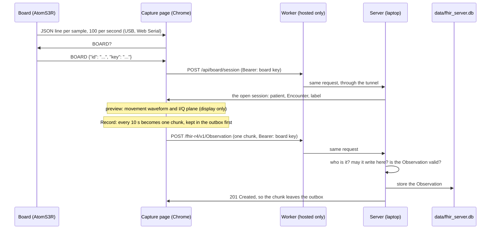
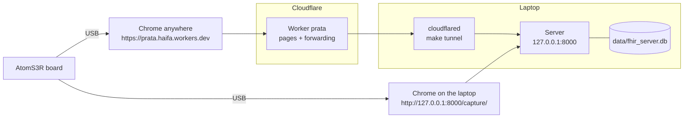

# How PRATA works

This explains the whole program from the radar to the database: what each part does,
how a recording travels, who may see what, and what happens when something breaks. It
describes the code as of 2026-11-19. To *run* things, use `README.md` and
`docs/RUN-GUIDE.md`.

Words used below:
- **FHIR**: the medical data format the server speaks. Every record is a JSON
  "resource" with a type (Patient, Observation, ...).
- **SATUSEHAT**: Indonesia's national health data platform. PRATA copies its rules and
  identifier systems but never connects to it.
- **Encounter**: FHIR's word for a visit. Here, one recording session.
- **Observation**: one measured result. Here, 10 seconds of raw radar signal.

## 1. The pieces

| Piece | Folder | What it does |
|---|---|---|
| Board firmware | `firmware/radar_json/` | Runs on the M5Stack AtomS3R. Samples the radar's I and Q channels and the motion sensor 100 times a second and writes one JSON line per sample over USB |
| Website | `website/` | Three pages served at `/capture/`: **Sessions** (log in, plan who is recorded with which board), **Capture** (read the board, show the signal, record), **Review** (compare display methods on a saved file) |
| Worker | `hosting/` | Only when hosted. A small Cloudflare program at `https://prata.haifa.workers.dev` that serves the pages and passes API calls on to the laptop |
| Tunnel | `cloudflared` (`make tunnel`) | Only when hosted. A connection the laptop opens out to Cloudflare, so the Worker can reach the server without opening any port on the laptop |
| Server | `fhir_server/` | Checks who is asking, checks every record against the rules, and stores it. Listens on `127.0.0.1:8000` |
| Database | `data/fhir_server.db` | One SQLite file on the laptop. Everything the server stores is here |

## 2. One recording, end to end

Step by step:

1. **The board samples.** A timer reads I (pin G7), Q (pin G8) and the motion sensor 100
   times a second and prints each sample as one JSON line over USB
   (`firmware/radar_json/radar_json.ino`, `firmware/radar_json/sampling.h`).
2. **The Capture page reads the board** through Chrome's Web Serial
   (`website/src/serial.js`). It sends `BOARD?`. The board answers with its chip ID and a
   key it made on first boot (`firmware/radar_json/board.h`, `website/src/board.js`).
3. **The page asks which session the board belongs to.** It posts the ID to
   `/api/board/session`, with the board's key as the password. The server answers with the
   patient, the Encounter and the label of the board's open session, or says there is none
   (`fhir_server/services/sessions.py`, `board_session`).
4. **The preview runs.** The page turns the last 10 s of I and Q into a movement
   waveform and draws the I/Q plane (`website/src/dsp/pipeline.js`, method `hybrid` by
   default). This is display processing only. It is not a measurement.
5. **Record.** Samples are grouped into chunks of 1000 samples (10 s) per channel
   (`website/src/chunker.js`). Each chunk becomes one FHIR Observation with code
   `raw-capture`, holding 8 channels as space-separated numbers
   (`website/src/observation.js`).
6. **The outbox keeps every chunk until the server confirms it.** Chunks are stored in the
   browser's IndexedDB first (`website/src/outbox.js`). The uploader sends them one by one
   with the board key as the login (`website/src/uploader.js`). If the server cannot be
   reached, or answers 5xx, 408 or 429, it waits 1, 2, 4, 8, 16, then 30 seconds between
   tries and keeps the chunk. Closing the tab does not lose it.
7. **Hosted only: the Worker passes the request on** (`hosting/src/worker.js`). It
   forwards the method, path, query, headers and body unchanged to the laptop through the
   tunnel, drops cookies, and passes the answer back.
8. **The server checks and stores.** It works out who is asking
   (`fhir_server/routes/deps.py`): a board key may only write into its own open session.
   It checks the Observation against the rules (`fhir_server/validation/`) and stores it
   in `data/fhir_server.db` (`fhir_server/repositories/resources.py`). A rejected
   Observation writes nothing and comes back as an error message (OperationOutcome).
9. **Stop.** The page waits until the outbox is empty, then shows
   **✓ Saved: … stored on the server** (`website/src/recstate.js`).

## 3. Logging in and roles

People log in on the Sessions page. The page posts the username and password to
`/auth/token` (`fhir_server/routes/auth.py`). The server checks the password against
its stored hash (PBKDF2, `fhir_server/auth/passwords.py`) and returns a signed login
token (a JWT, `fhir_server/auth/jwt.py`). The token:

- lasts **one hour** (`FHIR_JWT_TTL`, default 3600 s);
- carries the account ID, the role (admin, doctor or patient) and the linked record
  (`Practitioner/...` for a doctor, `Patient/...` for a patient);
- is kept in the browser's `localStorage` as `prata-auth`, so every tab shares it.

Every later request sends the token. The server also checks that the account is still
active, so a disabled account is refused on its next request.

Who may do what (`fhir_server/authz.py`, `fhir_server/services/sessions.py`):

| | admin | doctor | patient | board (its key) |
|---|---|---|---|---|
| Register boards, create test patients | yes | no | no | no |
| Open and end sessions | any session, for any doctor | only for patients they already take part in; ends only their own | no | no |
| Read patients | all | only patients in their own Encounters | only their own | no |
| Read Encounters and Observations | all | only their own Encounters and those Encounters' Observations | only their own | no |
| Write Observations | yes | no | no | only into its open session |
| Delete anything | yes | no | no | no |
| Manage accounts | on the laptop only (`add-account`, see `docs/accounts/README.md`) | no | no | no |

## 4. Boards and sessions

- **Board identity.** The board ID is its chip's factory address (12 hex characters).
  The key is 64 random hex characters the board made on first boot and keeps in its flash
  memory. The simulated board on the Capture page has an ID `SIM-xxxxxxxx` and keeps its
  key in the browser.
- **Registering** (admin, once per board) stores only a hash of the key
  (`fhir_server/repositories/boards.py`) and creates a FHIR Device for the board.
- **Test patients** are made by an admin on the Sessions page: *Sesi S001* with a
  synthetic NIK starting `9900`. No real patient data is used.
- **A session** ties one board to one patient and one doctor under a label. Opening it
  creates an Encounter (the visit). While it is open, the board's key may write
  Observations into it. Ending it finishes the Encounter and frees the board.

## 5. What is stored

Everything is in `data/fhir_server.db`:

| Table | Holds |
|---|---|
| `resources` | Every FHIR resource as JSON: Organization and Location (the clinic, from seeding), Practitioner (doctors), Patient, Device (boards), Encounter (sessions), Observation (recorded chunks) |
| `accounts` | Logins: username, password hash, role, linked record, active or not |
| `boards`, `board_sessions` | Registered boards (key hash only) and their sessions |
| `device_tokens`, `conditional_keys` | Older device tokens (Python device client, tests) and duplicate-create protection |

Nothing is written to CSV or WAV. To get a recording out, search its Observations
(`docs/RUN-GUIDE.md`, Step 10) and load the result on the Review page.

## 6. When something fails

| What happens | What you see | What the system does |
|---|---|---|
| The laptop server is stopped, or the tunnel is down (hosted) | The Worker answers 503 *PRATA server is offline (laptop off or tunnel down).* The Capture page shows *Server unreachable, retrying.* | Chunks wait in the browser's outbox and upload when the server is back. Each chunk has a fixed identifier, so a chunk sent twice is stored once |
| Too many logins from one address (hosted) | *Login failed: Too many login attempts. Try again in a minute.* | The Worker answers 429 without asking the laptop. Cloudflare counts approximately, so a slow guesser may never hit it (see `docs/design/specs/2026-11-19-tidy-up-and-cloudflare-hosting-design.md`, live check results) |
| Someone calls the account API from the web | 403 *Account management is only available on the PRATA laptop.* | Accounts are managed only with the laptop commands |
| The server rejects a record | The server's own message, for example a missing field | Nothing is written. The page shows the message |
| The login expires (after one hour) | The Sessions page shows the login form again | Recording keeps uploading: the board key, not your login, sends the chunks |

## 7. Local and hosted

The same pages and the same server run in both cases. Hosting adds the Worker and the
tunnel in front.

- **Local:** `make server`, open `http://127.0.0.1:8000/capture/`. Only this laptop can
  reach it.
- **Hosted:** `make server` **and** `make tunnel` on the laptop. Anyone can open the
  address; only accounts you create can log in. The board is still plugged into the
  computer whose Chrome has the Capture page open. The pages are copied to Cloudflare by
  `make deploy` (needed only when pages or the Worker change). The data never leaves the
  laptop's database.

## 8. Not built yet

- **The doctor's integrated view:** RME, RADAR JVP and 12-lead ECG together in one view,
  the thesis goal. The website architecture for it is not designed yet. See the
  placeholder in `docs/accounts/doctor.md`.
- **The patient's own-record page.** The server already lets a patient read their own
  records through the API; there is no page for it. See `docs/accounts/patient.md`.
- **ECG input.** Nothing reads 12-lead ECG data yet.
- **Radar-derived measurements.** The firmware's heart-rate values (WiFi path) are
  placeholders, and the movement waveform is display processing only.
- **Board key protection.** The board hands its key to anything that sends `BOARD?`.
  The planned fix is challenge and response
  (`docs/design/specs/2026-11-18-board-sessions-and-navigation-design.md`).
