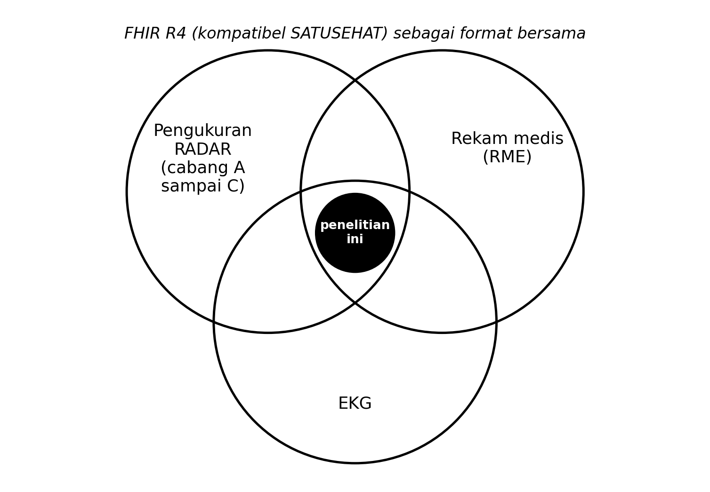
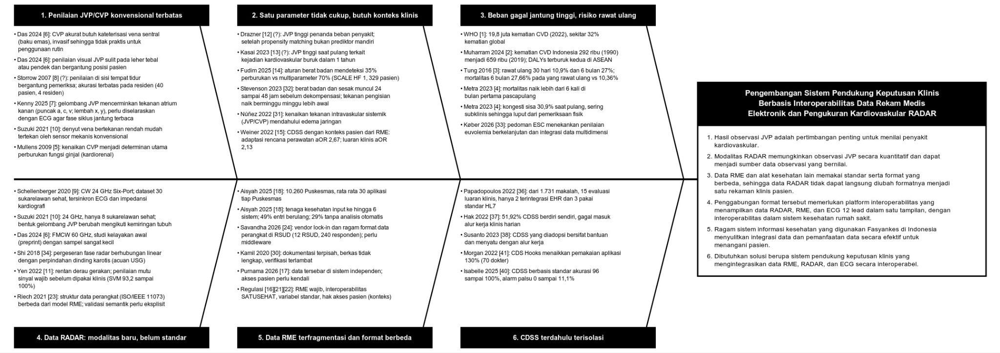
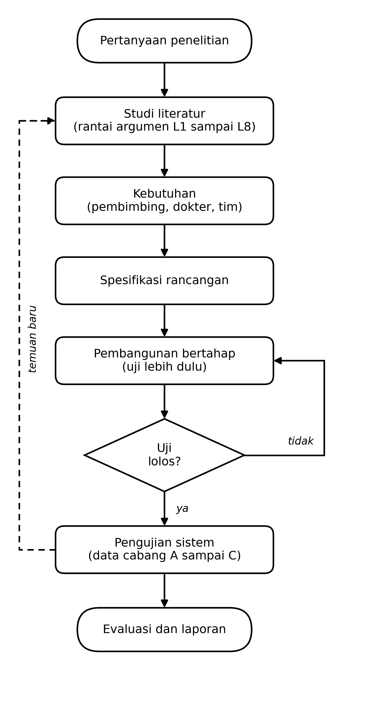
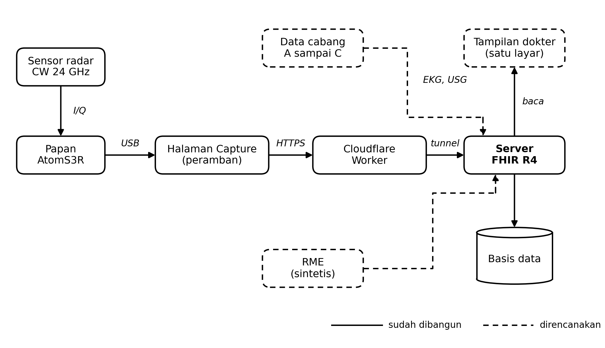
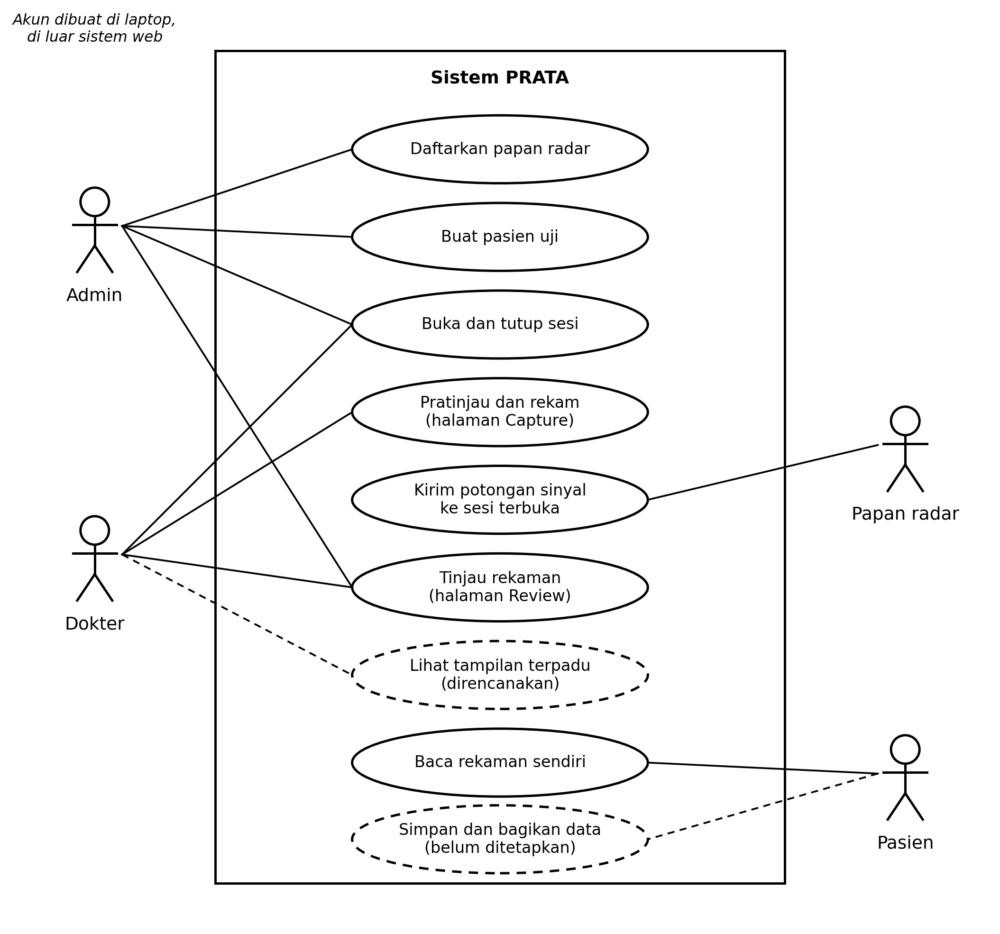
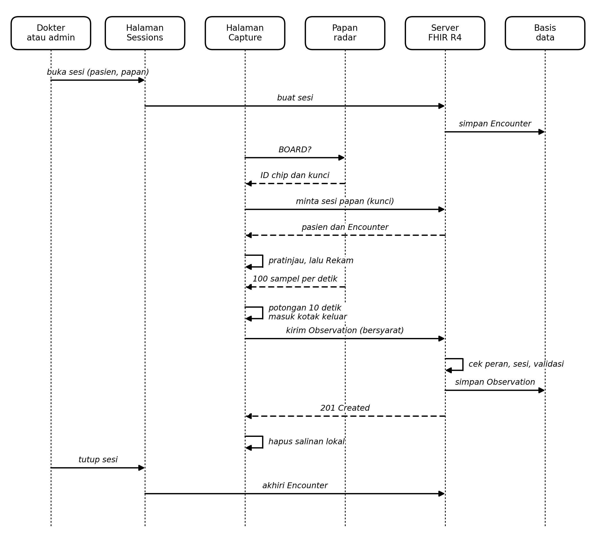
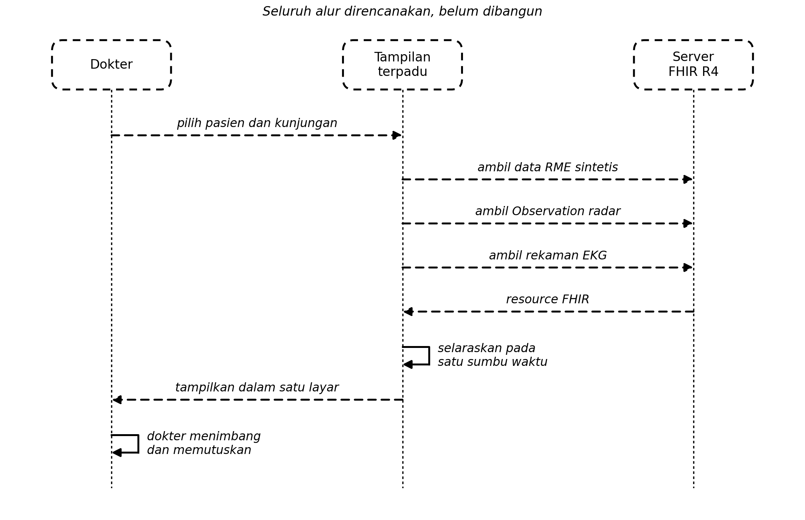
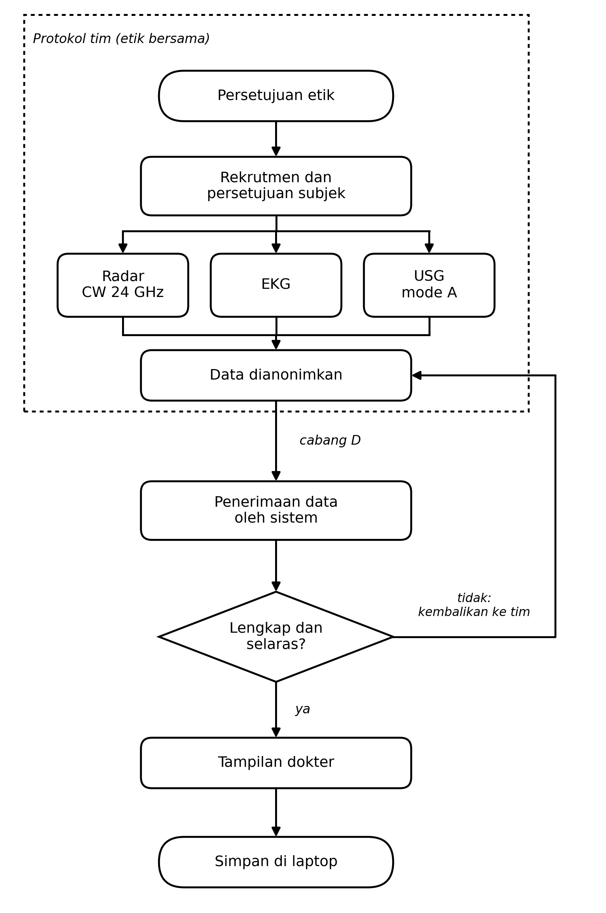
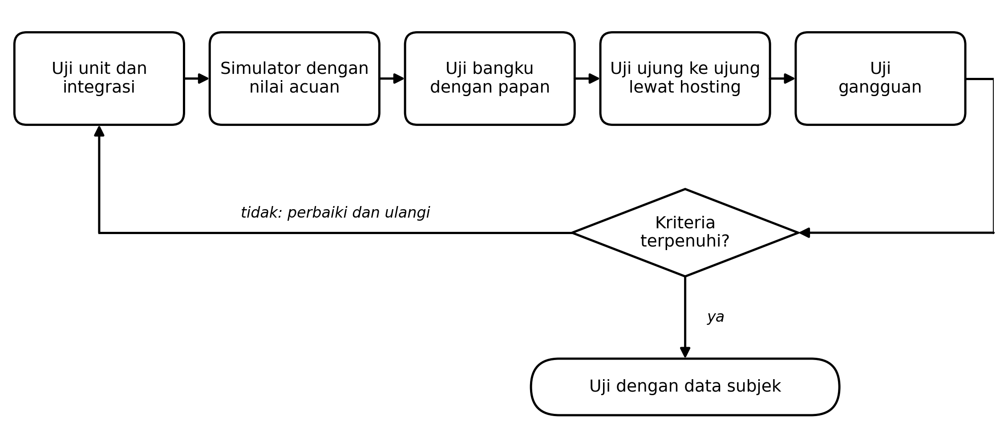

# PROPOSAL TUGAS AKHIR

## Judul:
Pengembangan Sistem Pendukung Keputusan Klinis Berbasis Interoperabilitas Data Rekam Medis Elektronik dan Pengukuran Kardiovaskular RADAR

## Judul (Inggris):
Development of a Clinical Decision Support System Based on the Interoperability of Electronic Medical Record Data and RADAR Cardiovascular Measurements

---

## ABSTRAK

Pasien gagal jantung sering dirawat ulang setelah pulang, dan salah satu pemicunya adalah kongesti vena yang belum tertangani. Denyut vena jugularis mencerminkan tekanan atrium kanan, tetapi pemeriksaannya di sisi tempat tidur bergantung pada keterampilan pemeriksa, sedangkan pengukuran tekanan vena sentral memerlukan kateter. Kelompok riset tempat penelitian ini berada mengembangkan pengukuran nirkontak dengan radar gelombang kontinu 24 GHz pada leher. Hasil pengukuran itu belum bermakna bila dibaca sendiri, karena makna gelombang vena bergantung pada riwayat, obat, dan rekaman elektrokardiogram pasien yang tersimpan di sistem lain dengan format berbeda. Penelitian ini bertujuan membangun sistem pendukung keputusan klinis berbasis web yang menerima hasil pengukuran radar, rekaman elektrokardiogram dua belas sadapan, dan data rekam medis elektronik, lalu menampilkannya bagi dokter dalam satu tampilan dengan satu sumbu waktu. Seluruh data disimpan dalam standar Fast Healthcare Interoperability Resources versi R4 yang kompatibel dengan platform SATUSEHAT. Metode penelitian bersifat rekayasa sistem: spesifikasi rancangan ditulis lebih dulu, sistem dibangun bertahap dengan pengujian otomatis, lalu diuji berjenjang dari simulator, uji bangku dengan papan radar, sampai data subjek yang dipakai ulang dari cabang penelitian lain dalam kelompok yang sama. Penelitian ini tidak mengumpulkan subjek baru, dan data rekam medis yang dipakai bersifat sintetis. Purwarupa yang sudah berjalan mampu merekam sinyal mentah dari papan radar, menyimpannya tanpa kehilangan maupun duplikasi data, dan diakses melalui alamat publik. Hasil yang diharapkan adalah sistem yang memetakan ketiga sumber data ke satu format bersama dan menyajikannya secara utuh kepada dokter. Keluaran sistem berfungsi sebagai pendukung pertimbangan klinis, sementara keputusan tetap berada di tangan dokter.

Kata kunci: FHIR, SATUSEHAT, interoperabilitas, sistem pendukung keputusan klinis, RADAR, jugular venous pulse, rekam medis elektronik.

---

## ABSTRACT

Patients with heart failure are often readmitted after discharge, and one of the triggers is venous congestion that has not been resolved. The jugular venous pulse reflects right atrial pressure, but its bedside assessment depends on the examiner's skill, while measuring central venous pressure requires a catheter. The research group in which this study takes place is developing a contactless measurement on the neck using a 24 GHz continuous wave radar. The result of that measurement has little meaning when read on its own, because the meaning of the venous waveform depends on the patient's history, medication, and electrocardiogram recordings, which are stored in other systems with different formats. This study aims to build a web based clinical decision support system that receives radar measurement results, twelve lead electrocardiogram recordings, and electronic medical record data, and then displays them for the doctor in one view on one time axis. All data are stored in the Fast Healthcare Interoperability Resources standard, version R4, compatible with the SATUSEHAT platform. The research method is system engineering: design specifications are written first, the system is built incrementally with automated tests, and it is then tested in stages, from a simulator, through bench tests with the radar board, to subject data reused from other branches of research in the same group. This study does not collect new subjects, and the medical record data used are synthetic. The prototype that already runs can record raw signals from the radar board, store them without loss or duplication, and be accessed through a public address. The expected result is a system that maps the three data sources to one shared format and presents them in full to the doctor. The system output serves as support for clinical judgement, while the decision remains with the doctor.

Keywords: FHIR, SATUSEHAT, interoperability, clinical decision support system, RADAR, jugular venous pulse, electronic medical record.

---

## BAB I PENDAHULUAN

### 1.1 Latar Belakang

Penyakit kardiovaskular adalah penyebab kematian terbesar di dunia. World Health Organization (WHO) memperkirakan 19,8 juta orang meninggal karena penyakit kardiovaskular pada 2022, setara dengan 32% dari seluruh kematian tahun itu [1]. Di Indonesia, kematian akibat penyakit kardiovaskular naik dari sekitar 292 ribu pada 1990 menjadi sekitar 659 ribu pada 2019, dengan stroke dan ischemic heart disease (IHD) sebagai penyumbang terbesar [2]. Gagal jantung adalah sindrom klinis yang membuat beban ini terus kembali ke rumah sakit. Pada satu kohort, 10,9% pasien gagal jantung dirawat ulang dalam 30 hari dan 27% dalam enam bulan [3]. Salah satu pemicunya adalah kongesti sisa, yaitu kelebihan cairan yang belum tertangani saat pasien dipulangkan, dan sekitar 30,9% pasien yang dipulangkan masih menunjukkan tanda kongesti sisa [4]. Kongesti vena umumnya dinilai dari peningkatan central venous pressure (CVP), yang diukur lewat kateterisasi vena sentral dan umumnya hanya dilakukan di rumah sakit dengan fasilitas khusus [5], [6]. Jalan lain adalah menilai denyut vena jugularis atau jugular venous pulse (JVP), yang mencerminkan tekanan atrium kanan [7]. Di sisi tempat tidur, JVP dinilai secara kualitatif oleh dokter dengan two object method, memakai penggaris tegak dan benda lain seperti kartu untuk melihat pulsasi vena [8]. Cara ini dilaporkan memiliki reliabilitas uji yang baik (82,9%), tetapi sensitivitasnya rendah (43,3%) dan spesifisitasnya juga rendah (67,7%) untuk mendeteksi kenaikan CVP [cite: sumber angka two object method].

RADAR memungkinkan penilaian JVP secara kuantitatif. Prinsipnya memanfaatkan efek Doppler dan hamburan balik: perbedaan fase gelombang radio yang dipantulkan kulit di atas vena jugularis menunjukkan gerakan mikro akibat pulsasi pembuluh [9]. Pembacaan tanda vital dengan RADAR menjadi modalitas yang menjanjikan. Beberapa studi memakai RADAR continuous wave (CW) maupun frequency modulated continuous wave (FMCW) untuk merekam respirasi dan gerakan mekanis jantung dengan akurasi tinggi bila dibandingkan dengan metode konvensional [9], [10]. Beberapa studi juga memakai RADAR untuk mendeteksi JVP di permukaan leher tanpa kontak, meskipun masih berupa studi kelayakan dengan subjek yang sangat sedikit [6], [10]. Di ruang rawat inap, pembacaan RADAR rentan terhadap artefak gerakan tubuh, sehingga mutu sinyal perlu dievaluasi sebelum dipakai sebagai data klinis [11].

Penelitian ini merupakan satu cabang dari pohon penelitian kelompok riset Teknik Biomedik ITS bersama RSUD Dr. Soetomo. Seluruh cabang memakai platform radar CW 24 GHz yang sama. Cabang A merekam morfologi pulsa karotis pada irama normal dan aritmia dengan EKG sebagai acuan temporal, cabang B menilai asimetri pulsa karotis kiri dan kanan pada penyakit arteri koroner, dan cabang C mengestimasi JVP dari pulsasi vena jugularis interna dengan ultrasound mode A sebagai acuan. Ketiga cabang itu mengumpulkan data subjek di bawah satu proposal etik bersama. Penelitian ini adalah cabang keempat, yang tidak merekam subjek baru. Proposal etik kelompok menuliskan tugas cabang ini sebagai penyusunan profil FHIR untuk keluaran radar dengan memakai ulang data cabang A sampai C. Dalam tugas akhir ini, format FHIR tersebut menjadi lapisan interoperabilitas di dalam sistem pendukung keputusan klinis, dan perluasan cakupan ini perlu disampaikan kepada tim agar tercermin dalam proposal etik. Cabang ini membangun sistem yang menerima hasil ketiga cabang tersebut dan menyajikannya bersama data pasien lain.

Sinyal JVP memiliki beberapa fitur, yaitu puncak a, c, dan v serta lembah x dan y yang mencerminkan relaksasi dan kontraksi atrium kanan, dengan variasi antarpasien yang tinggi [7]. Variasi itu dipengaruhi penggunaan obat, berat badan, hasil laboratorium, kunjungan sebelumnya, riwayat penyakit, dan faktor lain, dan bukti klinisnya belum seragam. Satu analisis dengan pencocokan skor kecenderungan menemukan bahwa JVP yang tinggi menandai keparahan penyakit yang lebih berat, tetapi setelah pencocokan tidak berhubungan sendiri dengan kematian maupun rawat inap [12]. Studi lain melaporkan bahwa JVP yang masih tinggi saat pulang berkaitan dengan kejadian kardiovaskular buruk dalam satu tahun berikutnya [13]. Jadi JVP tidak layak dibaca sendiri tanpa mempertimbangkan faktor lain. Penilaian gagal jantung memerlukan lebih dari satu parameter. Pada uji SCALE HF 1, aturan berat badan saja hanya mendeteksi 35% kejadian perburukan gagal jantung, sedangkan indeks kongesti multiparameter mencapai 70% [14]. Uji acak lain menunjukkan bahwa sistem pendukung keputusan klinis atau clinical decision support system (CDSS) yang memanfaatkan informasi tambahan dari rekam medis meningkatkan kualitas penanganan pasien [15].

Data dan informasi pasien tersimpan di rekam medis elektronik (RME). Peraturan Menteri Kesehatan Nomor 24 Tahun 2022 tentang Rekam Medis mewajibkan fasilitas pelayanan kesehatan menyelenggarakan RME, sehingga setiap kunjungan menghasilkan sedikitnya satu dokumen RME [16]. Masalahnya, data yang dibutuhkan untuk keputusan klinis tersebar di banyak aplikasi yang berdiri sendiri. Survei Aisyah dkk. terhadap 10.260 Puskesmas mencatat sekitar 30 aplikasi sistem informasi kesehatan per Puskesmas, dan 49% di antaranya menuntut entri data berulang [18]. Data dari perangkat pengukuran juga perlu masuk ke RME. Sebagian data seperti ini dikenal sebagai patient generated health data (PGHD), yaitu data yang dihasilkan di luar kunjungan klinis, dan telaah sistematis melaporkan bahwa akses pasien ke rekam medisnya meningkatkan kesadaran, keterlibatan, dan kualitas hidup pasien serta mengurangi kekhawatiran [19]. Pengukuran RADAR pada penelitian ini dilakukan di poliklinik, sehingga datanya diperlakukan sebagai data perangkat pengukuran, bukan PGHD. Untuk berbagai jenis data tersebut terdapat standar global yang berbeda fungsinya: International Classification of Diseases (ICD) untuk klasifikasi penyakit, Systematized Nomenclature of Medicine Clinical Terms (SNOMED CT) untuk istilah klinis, dan LOINC untuk kode observasi dan laboratorium. Standar tersebut tidak dapat langsung dimasukkan ke sembarang sistem informasi.

Health Level Seven (HL7), organisasi nirlaba pengembang standar kesehatan, mengembangkan Fast Healthcare Interoperability Resources (FHIR) sebagai lapisan interoperabilitas data klinis berbasis Representational State Transfer Application Programming Interface (REST API) yang menghubungkan perangkat medis, RME, sistem administrasi, dan catatan dokter [25]. Di Indonesia, ekosistem sistem informasi kesehatan memakai SATUSEHAT Platform (SSP) yang berbasis FHIR R4 [20] dan berlandaskan hukum. Variabel RME ditetapkan dalam Keputusan Menteri Kesehatan Nomor HK.01.07/Menkes/1423/2022 [21], dan UU Nomor 17 Tahun 2023 tentang Kesehatan mewajibkan sistem informasi serta teknologi kesehatan mengikuti standar [22]. Perangkat portabel dan RADAR memakai format keluaran sendiri yang strukturnya berbeda dari model data RME [23], padahal sebagai teknologi kesehatan keduanya termasuk yang wajib mengikuti standar tersebut [22]. Studi campuran di 12 RSUD tipe C dan D menemukan bahwa ragam format data perangkat yang bergantung pada vendor menjadi salah satu hambatan interoperabilitas [24]. Dengan ragam format dan sistem di fasilitas pelayanan kesehatan (Fasyankes), pemanfaatan RME bersama alat kesehatan untuk keputusan klinis memerlukan satu format bersama yang sejalan dengan ekosistem SATUSEHAT.

Data JVP dari RADAR, rekam medis, dan EKG kini berada di tempat yang terpisah dengan format yang berbeda. Akibatnya dokter sulit melihat semuanya dalam satu tampilan yang konsisten. Diperlukan sistem yang menyatukan hasil pengukuran RADAR dengan RME dan EKG, lalu menyajikannya secara utuh untuk membantu pertimbangan klinis.

### 1.2 Rumusan Masalah

Pengukuran JVP adalah pertimbangan penting dalam menilai kongesti pada penyakit kardiovaskular. Modalitas RADAR memungkinkan pengukuran JVP secara kuantitatif dan nirkontak, tetapi hasilnya bersifat pelengkap dan tidak menentukan keputusan bila berdiri sendiri. Data RME dan alat kesehatan lain memakai standar serta format yang berbeda, sehingga data RADAR tidak dapat langsung menjadi bagian dari satu rekaman klinis pasien. Ragam sistem informasi kesehatan di Fasyankes Indonesia juga menyulitkan integrasi dan pemanfaatan data secara efektif untuk menangani pasien. Dibutuhkan solusi berupa sistem pendukung keputusan klinis yang mengintegrasikan data RME, hasil pengukuran RADAR, dan EKG 12 sadapan secara interoperabel, lalu menampilkannya bagi dokter dalam satu tampilan.

### 1.3 Batasan Masalah

Penelitian ini mengembangkan sistem informasi untuk hasil pengukuran platform radar CW 24 GHz milik kelompok riset, karena platform itulah yang tersedia dan menjadi dasar seluruh cabang penelitian. Perangkat RADAR, akuisisi sinyal, pengolahan I/Q, serta deteksi dan kuantifikasi pulsa berada di luar lingkup, karena dikerjakan oleh cabang A sampai C. Fokus penelitian adalah sistem yang mengintegrasikan RME, hasil pengukuran RADAR, dan EKG 12 sadapan sebagai titik acuan waktu. Penelitian ini tidak merekam subjek baru dan hanya memakai ulang data cabang A sampai C, sesuai proposal etik kelompok, dengan syarat data dianonimkan sebelum diserahkan. Syarat ini belum tertulis dalam proposal etik dan perlu dicantumkan pada bagian metode penelitiannya. Data RME memakai sumber sintetis atau data uji, karena data RME nyata memerlukan persetujuan etik tersendiri. Keluaran sistem berupa pendukung keputusan, bukan diagnosis, dan belum divalidasi secara klinis karena validasi klinis memerlukan studi terpisah dengan pasien nyata.

### 1.4 Tujuan dan Manfaat

Tujuan utama penelitian ini adalah membangun sistem pendukung keputusan klinis berbasis interoperabilitas yang mengintegrasikan data RME, hasil pengukuran JVP dari RADAR, dan EKG 12 sadapan. Secara khusus, penelitian ini dilakukan untuk merancang alur data dari penerimaan data sumber sampai tampilan bagi dokter, untuk memetakan data RADAR, EKG, dan RME ke standar FHIR R4 yang kompatibel dengan SATUSEHAT dengan kelengkapan pemetaan sedikitnya [insert data: target persentase kelengkapan pemetaan], untuk menjamin bahwa seluruh sampel yang dikirim tersimpan utuh tanpa duplikasi, dan untuk menampilkan ketiga sumber data pada satu sumbu waktu dengan selisih penyelarasan tidak lebih dari [insert data: toleransi penyelarasan waktu].

Hasil penelitian berupa rancangan, metode, dan purwarupa sistem yang dapat digunakan oleh dokter untuk melihat hasil pengukuran JVP dari RADAR bersama data RME dan EKG pasien dalam satu tampilan, sehingga pertimbangan klinis menjadi lebih mudah. Bagi pasien, sistem berpotensi memudahkan penyimpanan dan pengiriman data ke dokter lain, walaupun fitur ini belum ditetapkan sebagai bagian inti penelitian. Bagi pengembang sistem informasi kesehatan, hasilnya dapat menjadi contoh cara menghubungkan data perangkat pengukuran baru dengan RME.

### 1.5 Kontribusi

Penelitian ini berkontribusi pada interoperabilitas dan pengelolaan sistem di bidang kesehatan, berupa pola contoh untuk mengintegrasikan data pengukuran dari perangkat baru dengan RME berbasis standar, serta pengelolaan data lintas sumber untuk mendukung keputusan klinis. Kontribusi klinis maupun kontribusi algoritma interpretasi tidak diklaim dalam penelitian ini.

### 1.6 Hipotesis dan Asumsi

Sebagai penelitian rekayasa sistem, hipotesis penelitian ini bersifat rancangan. Hipotesisnya adalah bahwa satu format kanonik berbasis FHIR R4 mampu menampung hasil pengukuran RADAR, rekaman EKG, dan data RME, lalu menyajikan ketiganya pada satu sumbu waktu tanpa kehilangan data. Hipotesis ini dinilai dari keutuhan data yang tersimpan, kelengkapan pemetaan ke FHIR, dan ketepatan penyelarasan waktu. Penelitian ini berangkat dari beberapa asumsi. Cabang A sampai C dapat menyerahkan data yang telah dianonimkan beserta penanda waktu yang dapat diselaraskan. Data RME sintetis cukup mewakili variabel RME yang ditetapkan dalam Keputusan Menteri Kesehatan Nomor HK.01.07/Menkes/1423/2022 [21]. Urutan kanal I dan Q pada papan radar diasumsikan sesuai pemasangan, sampai dikonfirmasi oleh tim perangkat keras.

### 1.7 Definisi Istilah

Jugular venous pulse (JVP) adalah denyut kolom darah pada vena jugularis yang mencerminkan perubahan tekanan atrium kanan sepanjang siklus jantung. Rekam medis elektronik (RME) adalah rekam medis yang dibuat dengan sistem elektronik sesuai Peraturan Menteri Kesehatan Nomor 24 Tahun 2022 [16]. Fast Healthcare Interoperability Resources (FHIR) adalah standar HL7 untuk pertukaran data kesehatan dalam bentuk resource yang dapat diakses lewat REST API. Sistem pendukung keputusan klinis (CDSS) adalah sistem yang menyajikan data spesifik pasien untuk membantu dokter mengambil keputusan, sementara keputusan tetap berada pada dokter. Sinyal I/Q adalah dua kanal keluaran radar, in phase (I) dan quadrature (Q), yang bersama memuat perubahan fase pantulan akibat gerakan permukaan kulit. Sesi pengukuran adalah satu kunjungan pasien yang dibuka oleh dokter atau admin, dengan satu papan radar yang ditugaskan dan hanya boleh mengirim data selama sesi terbuka.


## BAB II TINJAUAN PUSTAKA
### 2.1 Penyakit Kardiovaskular, Gagal Jantung, dan Kongesti Vena

Penyakit kardiovaskular adalah kelompok gangguan jantung dan pembuluh darah. Menurut WHO, 85% kematiannya disebabkan serangan jantung dan stroke, dan lebih dari tiga perempat terjadi di negara berpenghasilan rendah dan menengah [1]. Beban di Indonesia tidak turun bermakna selama tiga dekade, dan laju tahun hidup disesuaikan disabilitas (DALYs) penyakit ini menempatkan Indonesia pada posisi terburuk kedua di ASEAN setelah Laos [2]. Gagal jantung adalah tempat beban itu berulang kali kembali ke rumah sakit. Pada kohort di Taiwan, kelompok yang dirawat ulang dalam 30 hari memiliki mortalitas enam bulan 27,66%, dibandingkan 10,36% pada kelompok lain, dan sebagian besar biaya perawatan gagal jantung dikaitkan dengan rawat inap ulang yang tidak terencana [3]. Fase setelah pulang adalah yang paling rentan: pernyataan ilmiah ESC melaporkan risiko kematian melonjak lebih dari enam kali lipat pada bulan pertama, mortalitas satu tahun mencapai 25% sampai 30%, dan sepertiga sampai separuh pasien dirawat ulang dalam enam bulan [4].

Kongesti bukan proses yang seragam. Tinjauan Biomarkers Working Group dari Heart Failure Association membedakan empat kompartemen kongesti, yaitu intravaskular paru, jaringan paru, intravaskular sistemik, dan jaringan sistemik, serta menempatkan kenaikan tekanan intravaskular sistemik (CVP dan JVP) sebagai peristiwa yang mendahului perpindahan cairan ke jaringan [31]. Akibatnya, kenaikan berat badan dan sesak napas tampak belakangan. Pernyataan ilmiah JACC menyebut keduanya baru muncul sekitar 24 sampai 48 jam sebelum dekompensasi akut, sementara tekanan pengisian jantung naik bertahap beberapa pekan sebelumnya, dan telemonitoring berbasis berat badan serta keluhan memberi hasil netral pada berbagai uji besar [32]. Data tunggal memang lemah. Aturan berat badan hanya mendeteksi 35% kejadian perburukan pada uji SCALE HF 1 yang melibatkan 329 pasien di delapan pusat, sedangkan indeks kongesti multiparameter mencapai 70% [14]. Pedoman ESC 2026 menekankan penilaian status euvolemia secara berkelanjutan, integrasi data multidimensi, dan pengawasan tanda kongesti residual [33]. JVP yang masih tinggi saat pulang pun berkaitan dengan kejadian kardiovaskular buruk dalam satu tahun berikutnya [13].

CVP adalah ukuran yang lazim dipakai untuk kongesti vena, dan kenaikannya dikaitkan dengan memburuknya fungsi ginjal pada gagal jantung dekompensasi akut karena gradien perfusi ginjal menurun [5]. Kateterisasi vena sentral menjadi baku emas, tetapi invasif sehingga tidak praktis untuk penggunaan rutin [6]. JVP menawarkan jalan lain. Vena jugularis interna tidak memiliki katup antara pangkalnya dan atrium kanan, sehingga bentuk gelombangnya mencerminkan tekanan atrium kanan [7]. Penilaian visual di sisi tempat tidur sulit, terutama pada leher yang tebal atau posisi pasien yang kurang tepat [6], dan satu studi kecil dengan empat dokter residen pada 40 pasien menunjukkan akurasinya terbatas pada pemeriksa yang masih berlatih [8]. Bukti itu memang terbatas, tetapi searah dengan kebutuhan akan pengukuran yang lebih objektif.
### 2.2 Deteksi Jugular Venous Pulse melalui Modalitas RADAR

Gelombang JVP berasal dari tekanan atrium kanan. Puncak a, c, dan v serta lembah x dan y menggambarkan kepatuhan pengisian ventrikel kanan dan fungsi katup trikuspid [7]. Kecepatan aliran vena jugularis memiliki dua gelombang pengosongan yang sinkron dengan lembah x pada sistol dan lembah y pada diastol, sehingga rekaman vena perlu diselaraskan dengan EKG atau Doppler arteri agar fase siklus jantung dapat dibedakan [7]. Dengan kata lain, bentuk gelombang membawa informasi yang lebih kaya daripada satu angka tekanan, dan informasi itu hanya terbaca bila waktunya dirujuk ke siklus jantung.

RADAR biomedis membaca gerakan permukaan tubuh yang sangat kecil lewat perubahan fase sinyal pantulan. Radar gelombang kontinu 24 GHz berbasis teknologi Six Port yang direkam serempak dengan EKG dan impedansi kardiografi telah menghasilkan dataset sekitar 24 jam dari 30 subjek sehat dalam lima skenario, termasuk manuver Valsalva, apnea, dan uji meja miring [9]. Gelombangnya juga dapat menembus pakaian tipis atau kasur, sehingga pasien tidak perlu melepas pakaian [9]. Pada pulsa karotis, pergeseran fase radar gelombang kontinu berhubungan linear dengan perpindahan dinding pembuluh yang diukur ultrasonografi [34], sehingga data perpindahan dinding yang direkam radar punya dasar fisik yang dapat dibandingkan dengan modalitas referensi. Radar medis di lingkungan rawat inap rentan terhadap gerakan pasien. Modul penilai mutu sinyal berbasis support vector machine mengklasifikasikan sinyal dengan akurasi 93,2% sampai 100%, dan laju detak jantung dari radar menyimpang hanya 0 sampai 4 denyut per menit dari sensor kontak pada pasien lansia rawat inap [11].

Untuk JVP secara khusus, Suzuki dkk. memakai sensor gelombang mikro 24 GHz berdaya 7 mW pada delapan sukarelawan sehat dengan sudut elevasi tubuh dari telentang sampai 75 derajat. Bentuk gelombang JVP berubah mengikuti kemiringan, yang menunjukkan sensor responsif terhadap perubahan tekanan hidrostatik vena, dan denyut vena yang halus tidak tertekan oleh sensor seperti pada transduser mekanis [10]. Das dkk. memakai RADAR FMCW 60 GHz dengan eigen beamforming untuk memisahkan sinyal vena jugularis dari arteri karotis, lalu membandingkan morfologi gelombang dengan photoplethysmography dan satu rekaman kateter vena sentral dari pasien gagal jantung stadium awal [6].
### 2.3 Rekam Medis Elektronik dan Data Pasien

RME menjadi kewajiban fasilitas pelayanan kesehatan, dengan prinsip keamanan, keutuhan, dan kerahasiaan data serta pembukaan jalur interoperabilitas [16]. Variabel dan metadata minimum RME rawat jalan, rawat inap, dan gawat darurat, termasuk identitas, tanda vital, diagnosis, prosedur, dan medikasi, diatur dalam Keputusan Menteri Kesehatan Nomor HK.01.07/Menkes/1423/2022 [21]. UU Nomor 17 Tahun 2023 menjadi payung hukum yang mengharuskan teknologi dan sistem informasi kesehatan mengikuti standar interoperabilitas, dan menegaskan hak pasien mengakses isi dokumen rekam medisnya [22]. Kerangka itu bermuara pada SATUSEHAT, platform terintegrasi Kementerian Kesehatan [cite: dokumentasi SATUSEHAT]. <!-- check:ok diagnosis -->

Survei lintas Puskesmas oleh Aisyah dkk. mencatat 10.260 Puskesmas dengan sekitar 30 aplikasi per Puskesmas, tenaga kesehatan yang memasukkan data ke hingga enam sistem, 49% sistem yang menuntut entri berulang, dan 29% sistem tanpa fitur analisis otomatis [18]. Studi campuran di 12 RSUD tipe C dan D pada tiga provinsi dengan 240 responden menemukan keterikatan vendor, ragam format data perangkat, dan keterbatasan infrastruktur, serta menyimpulkan perlunya lapisan perantara yang ringan dan mudah dihubungkan oleh pengembang perangkat baru [24]. Dari sisi hak pasien, kerangka DecMed memadukan buku besar terdistribusi IOTA dengan kendali akses berbasis kapabilitas, sehingga pasien dapat memberi, mencabut, dan membatasi masa berlaku akses dokter rujukan [17].

Data kesehatan yang dihasilkan pasien (PGHD) termasuk bagian dari RME. Telaah sistematis melaporkan bahwa akses pasien ke rekam medisnya meningkatkan kesadaran, pengelolaan mandiri penyakit kronis, dan kualitas hidup, serta mengurangi kekhawatiran pasien maupun tenaga kesehatan [19]. Contoh teknisnya, data dari perangkat Garmin telah dialirkan ke server FHIR melalui hub API dan dipetakan ke resource Observation dengan memperhatikan perlindungan data pribadi [27]. Konsep eSource menunjukkan bahwa data dapat diambil langsung dari RME lewat resource FHIR standar sehingga transkripsi manual berkurang dan integritas data terjaga [35].
### 2.4 Interoperabilitas melalui Platform FHIR

Terminologi klinis menjawab pertanyaan yang berbeda dari format pertukaran. ICD mengklasifikasikan penyakit, SNOMED CT menamai konsep klinis, dan LOINC mengodekan observasi serta pemeriksaan laboratorium [cite: dokumentasi resmi ICD, SNOMED CT, dan LOINC]. Tinjauan sistematis terhadap 49 studi FHIR di bidang riset kesehatan menemukan bahwa FHIR dipakai terutama untuk standardisasi data (41%), penangkapan data (29%), dan analisis klinis (12%), dan bahwa implementasinya sering dipasangkan dengan LOINC (37%), SNOMED CT (29%), dan ICD 10 (18%) [25].

FHIR menyusun data klinis sebagai resource modular yang dapat dibatasi melalui profil dan dipertukarkan lewat REST API, sehingga interoperabilitas sintaktik dan semantik dapat dicapai dalam satu kerangka [25]. Untuk perangkat medis, data berstandar ISO/IEEE 11073 dapat dipetakan ke resource Observation dan Device melalui panduan implementasi tanpa menghilangkan konteks asalnya, tetapi pemetaan itu menghadapi 25 tantangan teknis, dan profil yang valid secara sintaksis belum menjamin kebenaran semantik sehingga makna perlu divalidasi secara eksplisit [23]. Untuk aliran data, kerangka sumber terbuka yang memetakan sinyal fisiologis dari node sensor nirkabel ke FHIR Observation melaporkan latensi di bawah satu detik dan tanpa paket hilang [26].

Di Indonesia, panduan implementasi FHIR R4 untuk EKG 12 sadapan yang patuh SATUSEHAT memetakan standar HL7 aECG ke resource Observation, DiagnosticReport, dan Device. Dari 312 atribut aECG, 17 atribut ditetapkan sebagai permukaan pertukaran inti, dan keterbatasan SNOMED CT yang hanya mencakup 13 dari 32 tipe sadapan diatasi dengan provisional ValueSets [20]. Pada sisi pendukung keputusan, standar kontemporer memakai model data FHIR bersama Clinical Quality Language dan CDS Hooks, yang mengatasi masalah lama akses data lokal yang tertutup sehingga logika klinis dapat dipisahkan dari perangkat lunak RME dan dijalankan lintas institusi [29]. Dari sini FHIR dapat dipandang sebagai format kanonik: satu bentuk data yang menampung RADAR, EKG, dan RME agar dapat dibaca bersama. 

### 2.5 Sistem Pendukung Keputusan Klinis dan Manajemen Data

Sistem pendukung keputusan klinis (CDSS) adalah sistem berbasis pengetahuan yang aktif, memadukan data spesifik pasien untuk menghasilkan saran yang disesuaikan [36]. Dari 1.731 makalah CDSS berbasis aturan yang disaring, hanya 15 yang mengevaluasi luaran klinis secara ketat, hanya dua yang terintegrasi dengan EHR, dan hanya tiga yang memakai standar teknologi kesehatan resmi, seluruhnya standar HL7 [36]. Tinjauan sistematis lain menemukan bahwa modul berbasis aturan adalah pendekatan yang paling banyak dipakai dan paling transparan, dan bahwa 51,92% CDSS dibangun sebagai aplikasi yang berdiri sendiri [37]. Pada CDSS kardiovaskular berbasis pembelajaran mesin, sistem yang berhasil diadopsi umumnya bersifat bantuan: sintesis data disajikan, sedangkan keputusan tetap di tangan dokter, dan sistem harus menyatu dengan alur kerja yang sudah berjalan [38].

Arsitektur aliran data pada sistem semacam ini dapat dibagi menjadi penerimaan data, pemeriksaan mutu, penggabungan konteks, aturan, dan tampilan. Platform manajemen data medis berbasis FHIR dengan layanan microservices memisahkan modul komunikasi dari mesin aturan, dan dilaporkan memproses sekitar 50.000 transaksi per hari dengan lebih dari 400 model pendukung keputusan berbasis aturan [39]. Tahap pemeriksaan mutu penting karena sinyal radar di lingkungan klinis rentan terhadap derau gerakan [11]. EKG 12 sadapan berfungsi sebagai acuan waktu dan sinyal pembanding bagi data RADAR [9], termasuk untuk membedakan fase sistol dan diastol pada gelombang vena [7]. Pengelolaan basis data juga perlu mampu menyimpan dan menggabungkan data deret waktu dan data FHIR [cite: rujukan manajemen basis data untuk data deret waktu dan FHIR].

Cara sistem berinteraksi dengan dokter juga menentukan penerimaannya. CDS Hooks memicu layanan eksternal secara otomatis saat dokter membuka rekam medis pasien atau mencatat hasil pemeriksaan baru [29]. Evaluasi tiga perangkat CDSS berbasis standar (CQL, CDS Hooks, dan FHIR) pada rekam medis akademik menunjukkan akurasi 96% sampai 100% dan laju peringatan positif palsu 0,0% sampai 11,1% [40]. Pada uji acak klaster terhadap 70 dokter selama tujuh bulan, pemicu CDS Hooks meningkatkan pemakaian aplikasi SMART on FHIR sebesar 130% [41]. Temuan ini mengarah pada satu hal: rekomendasi perlu hadir tepat waktu dalam alur kerja tanpa menambah beban kognitif dokter.

### 2.6 Penelitian Terkait dan Kesenjangan Penelitian

Penelitian terkait dapat dikelompokkan menjadi tiga. Kelompok pertama adalah pengukuran JVP dan pulsa leher dengan RADAR. Suzuki dkk. menunjukkan bahwa sensor gelombang mikro 24 GHz menangkap perubahan bentuk gelombang JVP mengikuti sudut elevasi tubuh [10], Das dkk. memisahkan sinyal vena jugularis dari arteri karotis dengan RADAR FMCW 60 GHz [6], dan Schellenberger dkk. menyediakan rekaman RADAR yang disinkronkan dengan EKG sebagai acuan [9]. Seluruh studi ini berhenti pada sinyal dan validasinya, belum sampai pada bagaimana hasil pengukuran itu sampai ke dokter bersama data pasien lainnya. Kelompok kedua adalah integrasi data perangkat ke FHIR. Riech dkk. memetakan data perangkat berstandar ISO/IEEE 11073 ke FHIR [23], Adochiei dkk. mengalirkan sinyal fisiologis dari sensor nirkabel ke FHIR Observation [26], Abedian dkk. melakukan hal serupa untuk perangkat Garmin [27], dan Wesley dkk. memasukkan data luaran yang dilaporkan pasien ke tiga RME berbeda melalui SMART on FHIR [28]. Di Indonesia, Chaidir dan Hareva menyusun panduan implementasi FHIR R4 untuk EKG 12 sadapan yang patuh SATUSEHAT [20]. Kelompok ketiga adalah CDSS berbasis FHIR, misalnya platform manajemen data dengan ratusan model aturan [39] dan perangkat CDSS berbasis CQL, CDS Hooks, dan FHIR yang dievaluasi pada RME akademik [40].

Dari ketiga kelompok itu terlihat celah yang menjadi pijakan penelitian ini. Studi RADAR belum menghubungkan hasilnya dengan RME, studi integrasi FHIR menangani data perangkat berstandar ISO/IEEE 11073 [23], sinyal fisiologis sensor nirkabel [26], perangkat konsumen [27], dan data luaran pasien [28], tetapi tidak ada yang menangani sinyal I/Q radar yang belum memiliki kode standar, dan panduan EKG Indonesia hanya mencakup EKG. Sistem yang menyatukan hasil pengukuran JVP dari RADAR dengan RME dan EKG dalam satu tampilan bagi dokter tidak ditemukan dalam penelusuran literatur yang telah dilakukan. Ketiadaan ini adalah temuan penelusuran, bukan bukti bahwa sistem seperti itu belum pernah dibuat. Kebutuhan akan tampilan yang menyatu dengan alur kerja juga didukung temuan bahwa tenaga kesehatan Indonesia menghargai dokumentasi elektronik yang terintegrasi bila rancangannya intuitif [30].



### 2.7 Rasional

Telaah literatur memperlihatkan bahwa penilaian kongesti dan denyut vena jugularis berperan penting dalam tatalaksana gagal jantung. RADAR hadir sebagai cara baru untuk menangkap gelombang JVP secara noninvasif dan nirkontak, sehingga menjadi alternatif bagi kateterisasi yang invasif dan pemeriksaan visual yang bergantung pada pemeriksa. Bukti klinis menunjukkan bahwa hasil pengukuran JVP tidak dapat berdiri sendiri sebagai indikator tunggal, karena maknanya bergantung pada konteks pasien seperti penyakit penyerta, riwayat obat, dan perubahan berat badan yang tersimpan dalam RME. Instrumen RADAR dan RME beroperasi dengan format, skema metadata, dan ekosistem yang terpisah, sehingga diperlukan lapisan interoperabilitas berbasis HL7 FHIR untuk menyatukan keduanya dalam satu model data kanonik.

Akar masalah yang melatarbelakangi penelitian ini dirangkum dalam diagram fishbone pada Gambar 2.2.



Karena itu penelitian ini difokuskan pada rekayasa sistem perangkat lunak pendukung keputusan klinis dan manajemen data terpadu, bukan pada pembuatan perangkat RADAR maupun penyusunan algoritma interpretasi baru, yang menjadi bagian cabang lain dalam kelompok riset. Rekaman EKG 12 sadapan dipakai sebagai titik acuan waktu agar fase mekanis denyut vena dapat dibaca terhadap siklus kelistrikan jantung. Sistem yang dibangun memadukan hasil pengukuran kardiovaskular dengan konteks RME untuk menyajikan tampilan menyeluruh bagi dokter. Luaran sistem diposisikan sebagai pendukung pertimbangan klinis bagi tenaga medis. Sistem ini bukan penentu diagnosis otomatis dan tidak menghasilkan skor risiko.

---

## BAB III METODOLOGI DAN PERANCANGAN SISTEM

Bab ini menjelaskan cara penelitian dijalankan dan rancangan sistem yang dibangun. Pembahasannya mencakup pendekatan dan alur penelitian, sumber data, perangkat yang dipakai, arsitektur sistem beserta kebutuhan dan alur kerjanya, rancangan penerimaan data, pemodelan data FHIR, antarmuka, keamanan, rancangan pengujian, etika penelitian, progres, dan rencana kerja. Bab ini berisi rancangan dan kriteria. Hasil pengujian lengkap akan dilaporkan pada buku tugas akhir.

### 3.1 Pendekatan dan Alur Penelitian

Penelitian ini memakai pendekatan perancangan dan implementasi sistem. Fokusnya bukan uji klinis, melainkan pembangunan purwarupa sistem pendukung keputusan klinis yang menerima hasil pengukuran RADAR, rekaman EKG, dan data RME, lalu menyimpannya dalam satu format bersama. Keluaran utama penelitian berupa rancangan sistem, perangkat lunak yang berjalan, dan hasil pengujian teknis.

Alur penelitian bersifat berulang. Alur dimulai dari pertanyaan penelitian, dilanjutkan studi literatur yang disusun sebagai rantai argumen delapan mata rantai (L1 sampai L8), lalu penggalian kebutuhan dari pembimbing, dokter mitra, dan cabang penelitian lain yang keluarannya akan diterima sistem. Setiap bagian sistem diberi spesifikasi rancangan tertulis sebelum dibangun. Spesifikasi memuat tujuan, hal yang berada di luar lingkup, keputusan rancangan beserta alasannya, dan syarat yang harus terpenuhi agar bagian itu dianggap selesai. Bagian tersebut kemudian dibangun dalam langkah kecil dengan pengujian yang ditulis lebih dulu daripada kode yang diujinya. Bila uji gagal, kode diperbaiki sebelum melangkah ke bagian berikutnya. Temuan yang tidak terduga saat pengujian dikembalikan ke tahap literatur dan kebutuhan.



### 3.2 Sumber Data dan Subjek


Penelitian ini tidak merekam subjek baru. Data pengukuran berasal dari cabang A sampai C dalam pohon penelitian yang sama, yang mengumpulkan data subjek di RSUD Dr. Soetomo di bawah satu proposal etik bersama. Cabang A menyediakan sinyal radar pulsa karotis beserta rekaman EKG sebagai acuan temporal, cabang B menyediakan sinyal radar karotis kiri dan kanan, dan cabang C menyediakan sinyal radar vena jugularis beserta nilai acuan dari ultrasound mode A. Data direncanakan diserahkan dalam keadaan telah dianonimkan, dan ketentuan ini perlu dicantumkan dalam proposal etik karena saat ini proposal etik baru menyebut pemakaian ulang data cabang A sampai C. Jumlah subjek, kriteria inklusi dan eksklusi, serta jadwal pengambilan data mengikuti protokol etik kelompok dan akan ditetapkan di sana [insert data: jumlah subjek dan kriteria dari protokol etik]. Pada konsultasi 15 Oktober 2026, jumlah sekitar 100 subjek dengan waktu lebih dari satu bulan telah dibahas bersama dokter mitra, tetapi angka ini belum final. Data RME berasal dari sumber sintetis atau data uji [insert data: sumber RME sintetis], karena RME nyata memerlukan persetujuan etik tersendiri.

### 3.3 Perangkat dan Perangkat Lunak

Perangkat keras yang dipakai adalah modul radar CW 24 GHz yang terhubung ke papan mikrokontroler M5Stack AtomS3R berbasis ESP32. Kanal I dan Q dibaca oleh ADC 12 bit pada tegangan acuan 3,3 V. Papan juga membawa sensor inersia (akselerometer dan giroskop) yang dikirim pada setiap sampel untuk menandai gerakan subjek. Firmware ditulis dengan Arduino dan dikompilasi memakai arduino cli. Server dibangun dengan Python dan menyimpan data dalam SQLite. Halaman web ditulis dengan JavaScript tanpa kerangka kerja dan membaca papan melalui Web Serial pada peramban Chrome. Akses publik disediakan oleh Cloudflare Worker yang meneruskan permintaan melalui Cloudflare Tunnel ke laptop peneliti. Pengujian otomatis memakai pytest untuk server dan node test untuk halaman web serta lapisan hosting.

### 3.4 Arsitektur Sistem

#### 3.4.1 Gambaran Umum

Sistem dirancang berlapis agar setiap lapisan dapat dibangun dan diuji secara terpisah. Lapisan akuisisi adalah papan radar yang mengirim satu rekaman per sampel melalui USB. Lapisan penangkapan adalah halaman Capture di peramban yang mengelompokkan sampel menjadi potongan berdurasi paling lama 10 detik lalu mengunggahnya ke server. Lapisan data adalah server FHIR R4 yang menyimpan pasien, dokter, kunjungan, perangkat, dan hasil pengukuran sebagai resource standar. Lapisan akses mengatur hak setiap peran. Lapisan hosting adalah Cloudflare Worker yang melayani halaman secara publik dan meneruskan permintaan API ke server di laptop, sehingga data tidak pernah disimpan di luar laptop. Halaman web tidak pernah membaca basis data secara langsung, karena seluruh permintaan melewati server dan aturan aksesnya. Penerimaan data cabang A sampai C, impor RME sintetis, dan tampilan terpadu bagi dokter adalah lapisan berikutnya yang masih direncanakan, dan pada Gambar 3.2 digambar dengan garis putus.



#### 3.4.2 Use Case Diagram

Use case diagram pada Gambar 3.3 menunjukkan siapa yang berinteraksi dengan sistem dan untuk keperluan apa. Aktornya ada empat. Admin mendaftarkan papan radar, membuat pasien uji, membuka dan menutup sesi, serta dapat meninjau seluruh rekaman. Dokter membuka sesi bagi pasiennya, menjalankan pratinjau dan perekaman di halaman Capture, dan meninjau rekaman di halaman Review. Papan radar adalah aktor perangkat yang hanya mengirim potongan sinyal ke sesinya yang sedang terbuka. Pasien membaca rekamannya sendiri. Dua fungsi digambar dengan garis putus karena belum dibangun. Tampilan terpadu bagi dokter masih direncanakan, sedangkan penyimpanan dan pembagian data oleh pasien belum ditetapkan sebagai bagian inti penelitian. Pembuatan akun berada di luar sistem web karena akun hanya dibuat dari laptop peneliti.



#### 3.4.3 Kebutuhan Sistem

Kebutuhan fungsional diturunkan dari peran pengguna. Untuk admin, sistem harus dapat mendaftarkan papan beserta identitasnya, membuat pasien uji dengan data sintetis, membuka dan menutup sesi bagi dokter mana pun, serta membaca seluruh data. Untuk dokter, sistem harus dapat membuka sesi hanya bagi pasien yang sudah ia tangani, menutup sesinya sendiri, merekam melalui halaman Capture, dan membaca kunjungan serta hasil pengukuran miliknya. Untuk pasien, sistem hanya membuka rekaman miliknya sendiri. Untuk papan radar, sistem hanya menerima hasil pengukuran ke sesi papan itu yang sedang terbuka. Pada tahap berikutnya sistem juga harus dapat menerima rekaman radar dan EKG dari cabang A sampai C, mengimpor RME sintetis, dan menampilkan ketiganya bagi dokter pada satu sumbu waktu.

Kebutuhan nonfungsional mencakup lima hal. Interoperabilitas berarti seluruh data disimpan sebagai resource FHIR R4 yang mengikuti profil, sistem identifier, dan terminologi SATUSEHAT. Keutuhan data berarti tidak ada sampel yang hilang tanpa tercatat dan tidak ada potongan yang tersimpan dua kali. Keamanan berarti setiap permintaan dikenali pengirimnya dan dibatasi oleh perannya. Ketersediaan berarti halaman dapat diakses melalui alamat publik selama laptop peneliti menjalankan server dan tunnel. Ketertelusuran berarti setiap bagian memiliki spesifikasi dan pengujian otomatis yang dapat dijalankan ulang.

#### 3.4.4 Alur Kerja Sistem

Alur kerja utama digambarkan dengan sequence diagram. Gambar 3.4 menunjukkan alur yang sudah dibangun, yaitu pembukaan sesi dan perekaman. Dokter atau admin membuka sesi untuk satu pasien dan satu papan, dan server mencatatnya sebagai Encounter. Halaman Capture menanyakan identitas papan, lalu meminta sesi milik papan tersebut ke server dengan kunci papan sebagai kredensial. Setelah pratinjau, perekaman dimulai. Setiap potongan 10 detik disimpan lebih dulu di peramban, dikirim ke server sebagai Observation, diperiksa peran, sesi, dan validitasnya, lalu disimpan. Salinan di peramban baru dihapus setelah server menjawab bahwa data tersimpan. Sesi ditutup dari halaman Sessions dan Encounter diakhiri.



Gambar 3.5 menunjukkan alur tinjauan dokter yang masih direncanakan. Dokter memilih pasien dan kunjungan, tampilan terpadu mengambil data RME sintetis, Observation radar, dan rekaman EKG dari server, menyelaraskannya pada satu sumbu waktu, lalu menampilkannya dalam satu layar. Keputusan tetap diambil oleh dokter.



### 3.5 Perancangan Akuisisi dan Penerimaan Data


Firmware mengambil sampel kanal I dan Q sebanyak 100 kali per detik dari pewaktu perangkat keras pada tugas tersendiri. Setiap sampel membawa nomor urut slot waktu, sehingga waktu yang hilang tampak sebagai celah dan tidak tersembunyi. Halaman Capture menyimpan setiap potongan di penyimpanan lokal peramban lebih dulu, lalu mengirimnya ke server, dan baru menghapusnya setelah server mengonfirmasi bahwa data tersimpan. Pengiriman ulang memakai pembuatan bersyarat, sehingga satu potongan tidak pernah tersimpan dua kali. Untuk data cabang A sampai C, sistem akan menerima berkas rekaman yang telah dianonimkan, memeriksa kelengkapan sampel dan penanda waktunya, lalu menyelaraskan rekaman radar dengan EKG pada satu sumbu waktu untuk rekaman yang memiliki EKG, yaitu rekaman cabang A. Apakah EKG yang direkam cabang A berupa 12 sadapan masih perlu dikonfirmasi [insert data: jenis rekaman EKG cabang A]. Rekaman yang tidak lengkap atau tidak dapat diselaraskan dikembalikan ke tim cabang terkait dan tidak ditampilkan kepada dokter.



### 3.6 Perancangan Pemodelan Data FHIR

Seluruh data disimpan dalam FHIR R4 yang kompatibel dengan SATUSEHAT, yaitu mengikuti profil, sistem identifier, dan terminologi SATUSEHAT secara lokal tanpa terhubung ke platform nasional. Resource yang dipakai adalah Patient, Practitioner, Organization, Location, Encounter, Device, dan Observation. Data yang tidak valid ditolak dengan OperationOutcome bergaya SATUSEHAT, sehingga tidak ada data setengah jadi yang tersimpan. Tabel 3.1 merangkum pemetaan setiap jenis data ke resource dan elemennya.

Tabel 3.1 Pemetaan data ke resource FHIR

| Data | Resource | Elemen utama | Sistem kode dan kode |
|---|---|---|---|
| Identitas pasien uji | Patient | identifier, name, gender, birthDate | NIK dan nomor IHS dengan sistem identifier SATUSEHAT |
| Dokter | Practitioner | identifier, name | NIK dengan sistem identifier SATUSEHAT |
| Fasilitas dan ruang | Organization, Location | identifier, name, managingOrganization | sistem identifier organisasi SATUSEHAT |
| Sesi pengukuran | Encounter | status, class, subject, participant, location, period | class AMB (ambulatory) dari HL7 v3 ActCode |
| Papan radar | Device | identifier, serialNumber, deviceName | nomor chip papan dengan code system lokal |
| Sinyal mentah satu potongan | Observation | code, subject, encounter, device, effectiveDateTime, component | code system lokal, kode raw capture; satuan UCUM |
| Delapan kanal sinyal | Observation.component | valueSampledData (origin, period, dimensions, data) | kode lokal per kanal: I, Q, tiga sumbu akselerometer, tiga sumbu giroskop |
| Rekaman EKG 12 sadapan (direncanakan) | Observation, DiagnosticReport, Device | mengikuti panduan implementasi EKG [20] | LOINC dan SNOMED CT sesuai panduan [20] |
| Data RME sintetis (direncanakan) | Condition, MedicationStatement, Observation | mengikuti variabel RME [21] | ICD 10, LOINC, dan SNOMED CT |

Sinyal mentah disimpan sebagai satu Observation per potongan. Setiap kanal menjadi satu komponen dengan SampledData, yaitu deret angka yang disertai titik nol (origin), selang antarsampel (period), dan satuannya. Pada laju 100 sampel per detik, selang antarsampel adalah 10 ms. Listing 3.1 memperlihatkan bentuk resource tersebut dengan isi data yang dipersingkat. Catatan mutu potongan, yaitu jumlah sampel yang hilang dan baris yang ditolak, disimpan pada elemen note agar celah data tetap tercatat. Karena kode standar untuk sinyal I/Q radar tidak ditemukan, sistem memakai code system lokal, dan hal ini dicatat sebagai keterbatasan.

```json
{
  "resourceType": "Observation",
  "status": "final",
  "code": {"coding": [{"system": "urn:prata:radar-signal",
                       "code": "raw-capture",
                       "display": "Raw radar I/Q capture"}]},
  "subject": {"reference": "Patient/P10000000001"},
  "encounter": {"reference": "Encounter/..."},
  "device": {"reference": "Device/..."},
  "effectiveDateTime": "2026-11-18T07:30:10+00:00",
  "component": [{
    "code": {"coding": [{"system": "urn:prata:radar-signal",
                         "code": "i-voltage"}]},
    "valueSampledData": {
      "origin": {"value": 0, "unit": "V",
                 "system": "http://unitsofmeasure.org", "code": "V"},
      "period": 10, "dimensions": 1,
      "data": "1.531 1.532 1.530 ..."}
  }]
}
```

Listing 3.1 Contoh Observation sinyal mentah yang dipersingkat

Rekaman EKG direncanakan mengikuti pemetaan panduan implementasi EKG yang patuh SATUSEHAT ke Observation, DiagnosticReport, dan Device [20]. Pemetaan RME sintetis mengikuti variabel dalam Keputusan Menteri Kesehatan Nomor HK.01.07/Menkes/1423/2022 [21]. Resource untuk RME pada Tabel 3.1 masih usulan dan akan ditetapkan setelah sumber RME sintetis dipilih. Profil yang valid secara sintaksis belum tentu benar secara makna [23], sehingga setiap pemetaan diperiksa juga dengan membandingkan nilai yang tersimpan dengan data asal.

### 3.7 Perancangan Antarmuka

Antarmuka dibangun sebagai halaman web yang memakai satu bilah navigasi bersama. Halaman Sessions dipakai admin dan dokter untuk masuk, mendaftarkan papan, membuat pasien uji, serta membuka dan menutup sesi. Halaman Capture membaca papan melalui Web Serial, menampilkan pratinjau, dan merekam ke sesi papan yang sedang terbuka. Halaman Review membuka berkas rekaman yang tersimpan, berupa CSV atau Bundle FHIR, untuk ditinjau ulang dan untuk membandingkan metode tampilan. Ketiga halaman ini sudah dibangun.

Tampilan terpadu bagi dokter direncanakan memuat konteks RME pasien, gelombang radar, dan EKG 12 sadapan pada satu sumbu waktu. Tampilan gelombang radar memakai metode tampilan yang dipilih dengan aturan tetap pada data sintetis yang nilai sebenarnya diketahui. Enam metode dibandingkan, aturan pemilihan ditulis sebelum metode dijalankan, dan metode hybrid terpilih dengan median skor 0,92. Pemilihan ini hanya memengaruhi apa yang dilihat dokter di layar dan tidak diklaim sebagai pengukuran maupun kontribusi penelitian, karena pengolahan sinyal adalah bagian cabang lain. Tampilan tidak memberikan diagnosis, prediksi, atau skor risiko. Penanda berbasis aturan hanya akan ditambahkan bila waktu memungkinkan.

### 3.8 Perancangan Keamanan

Keamanan dirancang berlapis. Lapisan pertama adalah akun. Akun dibuat hanya dari laptop peneliti, tidak ada pendaftaran mandiri, dan pengelolaan akun ditolak bila diakses dari internet, baik oleh Worker maupun oleh server. Kata sandi disimpan sebagai hash, dan pengguna yang masuk menerima token bertanda tangan yang berlaku satu jam. Lapisan kedua adalah peran. Admin mendaftarkan papan dan pasien uji serta dapat membuka dan menutup sesi mana pun. Dokter hanya dapat membuka sesi bagi pasien yang ia tangani. Papan hanya dapat menulis hasil pengukuran ke sesinya sendiri yang sedang terbuka. Pasien hanya dapat membaca rekamannya sendiri.

Lapisan ketiga adalah identitas papan. Identitas papan berasal dari nomor unik chip ESP32 dan kunci acak yang dibuat papan saat pertama kali menyala, dan server hanya menyimpan hash kunci tersebut. Lapisan keempat adalah jalur publik. Cloudflare Worker hanya meneruskan permintaan ke laptop melalui tunnel, menandai permintaan yang datang dari internet, dan tidak menyimpan data. Keterbatasan yang diketahui dicatat terbuka. Papan saat ini mengirim kuncinya kepada siapa pun yang memintanya melalui port, dengan perbaikan yang direncanakan berupa mekanisme tantangan dan jawaban. Pembatasan laju login menghentikan percobaan cepat, tetapi belum menghentikan tebakan yang lambat.

### 3.9 Perancangan Pengujian

Pengujian dilakukan berjenjang, dari yang murah dan terkendali sampai yang paling realistis, dan jenjang berikutnya baru dilalui bila jenjang sebelumnya lolos. Jenjang pertama adalah uji unit dan integrasi otomatis untuk server, halaman web, lapisan hosting, dan logika firmware. Jenjang kedua memakai papan simulasi yang menghasilkan sinyal dengan nilai acuan, untuk memastikan setiap sampel yang keluar dari papan tiba di basis data tanpa berubah. Jenjang ketiga adalah uji bangku dengan papan nyata. Jenjang keempat mengulang alur melalui alamat hosting, dan jenjang kelima sengaja menimbulkan gangguan, misalnya menghentikan server di tengah perekaman. Setelah kelima jenjang lolos, sistem diuji dengan data subjek dari cabang A sampai C.



Setiap kelompok pengujian memiliki metrik dan kriteria lolos yang ditetapkan sebelum pengujian, seperti pada Tabel 3.2.

Tabel 3.2 Rancangan pengujian

| Kelompok | Aspek yang diuji | Metrik | Kriteria lolos |
|---|---|---|---|
| Fungsional | Fungsi tiap peran, pembukaan sesi, perekaman, peninjauan | Hasil uji otomatis dan skenario manual | Seluruh uji lolos; keluaran sesuai skenario |
| Keutuhan data | Alur dari papan sampai basis data | Kelengkapan sampel (3.1), jumlah duplikat (3.2), celah tercatat | Kelengkapan 100% untuk sampel yang terkirim; duplikat nol; setiap celah tercatat |
| Interoperabilitas FHIR | Resource yang tersimpan dan hasil pemetaan EKG serta RME | Validasi FHIR R4, kelengkapan pemetaan (3.3) | Seluruh resource lolos validasi; kelengkapan sedikitnya [insert data: target kelengkapan pemetaan] |
| Penyelarasan waktu | Rekaman radar dan EKG yang diambil bersamaan | Galat penyelarasan (3.4) | Galat tidak lebih dari [insert data: toleransi penyelarasan waktu] |
| Keamanan dan peran | Akses tiap peran, kunci papan, pengelolaan akun dari internet | Kode status dan isi jawaban server | Akses sah diterima, akses tidak sah ditolak |
| Hosting dan gangguan | Alur melalui alamat publik, server mati di tengah perekaman | Waktu proses Worker, waktu pemulihan unggahan, duplikat | Seluruh potongan terunggah setelah server kembali tanpa duplikat |

Metrik keutuhan dan interoperabilitas dihitung dengan rumus berikut.

```rumus
K_sampel = (N_tersimpan / N_terkirim) × 100%   (3.1)
D = N_tersimpan dikurangi N_unik   (3.2)
K_pemetaan = (V_terpetakan / V_wajib) × 100%   (3.3)
e_i = | t_radar,i dikurangi t_EKG,i |   (3.4)
```

Pada Persamaan 3.1, N_tersimpan adalah jumlah sampel yang tersimpan di basis data dan N_terkirim adalah jumlah sampel yang dikirim papan menurut nomor urut slot waktunya. Pada Persamaan 3.2, N_unik adalah jumlah sampel dengan nomor urut yang berbeda, sehingga D bernilai nol bila tidak ada sampel yang tersimpan dua kali. Pada Persamaan 3.3, V_wajib adalah jumlah variabel wajib pada sumber data dan V_terpetakan adalah jumlah variabel wajib yang berhasil dipetakan ke elemen FHIR. Pada Persamaan 3.4, t_radar,i dan t_EKG,i adalah waktu peristiwa ke i yang dipasangkan pada rekaman radar dan EKG, dan galat penyelarasan dilaporkan sebagai nilai terbesar dan median dari seluruh e_i. Selain validasi oleh server sendiri, contoh resource juga akan diperiksa dengan HL7 FHIR Validator terhadap FHIR R4 [cite: HL7 FHIR Validator]. Hasil dianalisis secara deskriptif dengan membandingkan setiap nilai terhadap kriterianya.

### 3.10 Etika Penelitian dan Perlindungan Data

Pengambilan data subjek dilakukan oleh cabang A sampai C dan baru dimulai setelah proposal etik kelompok disetujui oleh komite etik penelitian kesehatan rumah sakit. Bagian metode, prosedur persetujuan subjek, dan risiko penelitian pada proposal etik masih dalam penyusunan, sehingga rinciannya mengikuti protokol yang disetujui nanti [insert data: prosedur persetujuan subjek dan penilaian risiko dari proposal etik]. Cabang ini tidak merencanakan tambahan subjek maupun prosedur. Data yang diterima direncanakan sudah dianonimkan dan hanya disimpan di laptop peneliti. Cloudflare Worker hanya meneruskan permintaan dan tidak menyimpan data. Pengelolaan data mengikuti prinsip kerahasiaan dalam Peraturan Menteri Kesehatan Nomor 24 Tahun 2022 [16] dan ketentuan pelindungan data pribadi yang berlaku [cite: Undang Undang Nomor 27 Tahun 2022 tentang Pelindungan Data Pribadi]. Data RME yang dipakai bersifat sintetis sehingga tidak memuat data pasien nyata.

### 3.11 Progres Penelitian

Per 26 November 2026, purwarupa sistem sudah berjalan dari papan radar sampai basis data dan dapat diakses melalui alamat publik. Pengujian otomatis yang dijalankan pada tanggal tersebut lolos seluruhnya, yaitu 236 uji server, 179 uji halaman web, dan 23 uji lapisan hosting. Status setiap komponen dirangkum pada Tabel 3.3. Pada uji bangku, kedua kanal papan diam berada di sekitar 1,53 V dengan sebaran sekitar 1 mV, dan sebaran naik menjadi 90 sampai 170 mV ketika ada gerakan di depan radar. Rekaman ini menunjukkan bahwa radar merespons gerakan, tetapi belum ditinjau sebagai sinyal fisiologis. Pada uji gangguan, seluruh potongan yang tertahan di peramban terunggah 16 sampai 17 detik setelah server kembali menyala tanpa duplikasi, dan waktu proses Worker tidak lebih dari 3 ms per permintaan. Nilai detak jantung yang dikirim firmware masih berupa nilai pengganti, bukan hasil pengukuran radar.

Tabel 3.3 Status komponen sistem

| Komponen | Status | Catatan |
|---|---|---|
| Firmware papan radar | Sudah dibangun dan diuji | Urutan kanal I dan Q masih asumsi |
| Halaman Capture dan unggah data | Sudah dibangun dan diuji | Diuji dengan simulator dan papan nyata |
| Server FHIR R4 dan validasi | Sudah dibangun dan diuji | Kompatibel SATUSEHAT secara lokal |
| Sesi, peran, dan identitas papan | Sudah dibangun dan diuji | Kunci papan masih dikirim tanpa enkripsi |
| Hosting Cloudflare | Sudah dibangun, diuji sebagian | Papan nyata belum diuji lewat alamat publik |
| Penerimaan data cabang A sampai C | Direncanakan | Menunggu format keluaran dari cabang |
| Impor RME sintetis | Direncanakan | Sumber data belum dipilih |
| Tampilan terpadu bagi dokter | Direncanakan | Setelah penerimaan EKG dan RME |

### 3.12 Rencana Kerja

Pekerjaan berikutnya disusun berurutan karena setiap langkah bergantung pada langkah sebelumnya. Langkah pertama adalah menyepakati format keluaran dengan cabang A sampai C, termasuk penanda waktu dan nilai acuan. Langkah kedua adalah membangun penerimaan rekaman EKG dan sinyal radar dari cabang tersebut. Langkah ketiga adalah memilih sumber RME sintetis dan membangun impornya. Langkah keempat adalah membangun tampilan terpadu bagi dokter. Langkah kelima adalah evaluasi dengan kriteria pada subbab 3.9, lalu penulisan laporan. Jadwal setiap langkah akan disesuaikan dengan jadwal pengambilan data kelompok, seperti pada Tabel 3.4.

Tabel 3.4 Rencana kerja

| Langkah | Luaran | Waktu |
|---|---|---|
| Kesepakatan format data dengan cabang A sampai C | Format berkas, penanda waktu, dan nilai acuan yang disepakati | [insert data: jadwal] |
| Penerimaan rekaman radar dan EKG | Impor berkas, pemeriksaan kelengkapan, dan pemetaan EKG ke FHIR | [insert data: jadwal] |
| Impor RME sintetis | Sumber RME terpilih dan pemetaannya ke FHIR | [insert data: jadwal] |
| Tampilan terpadu bagi dokter | Halaman yang menampilkan RME, radar, dan EKG pada satu sumbu waktu | [insert data: jadwal] |
| Evaluasi | Hasil pengujian terhadap kriteria Tabel 3.2 | [insert data: jadwal] |
| Penulisan laporan | Buku tugas akhir | [insert data: jadwal] |

## DAFTAR PUSTAKA
[1] World Health Organization, "Cardiovascular diseases (CVDs)." Accessed: Oct. 23, 2026. [Online]. Available: https://www.who.int/news-room/fact-sheets/detail/cardiovascular-diseases-(cvds)

[2] F. R. Muharram et al., "The 30 Years of Shifting in The Indonesian Cardiovascular Burden: Analysis of The Global Burden of Disease Study," Journal of Epidemiology and Global Health, vol. 14, pp. 193–212, Feb. 2024, doi: 10.1007/s44197-024-00187-8.

[3] Y.-C. Tung et al., "Worse Prognosis in Heart Failure Patients with 30-Day Readmission," Acta Cardiologica Sinica, vol. 32, no. 6, pp. 698–707, Nov. 2016, doi: 10.6515/ACS20151113A.

[4] M. Metra et al., "Pre-discharge and early post-discharge management of patients hospitalized for acute heart failure: A scientific statement by the Heart Failure Association of the ESC," European Journal of Heart Failure, vol. 25, no. 7, pp. 1115–1131, Jul. 2023, doi: 10.1002/ejhf.2888.

[5] W. Mullens et al., "Importance of venous congestion for worsening of renal function in advanced decompensated heart failure," Journal of the American College of Cardiology, vol. 53, no. 7, pp. 589–596, Feb. 2009, doi: 10.1016/j.jacc.2008.05.068.

[6] S. Das, H. Afsharan, G. Dwivedi, C. Arrow, and O. Kavehei, "A feasibility study on non-invasive and non-contact jugular venous pulse measurement using 60 GHz FMCW radar," R. Soc. Open Sci., vol. 12, no. 6, Art. no. 242231, Jun. 2025, doi: 10.1098/rsos.242231.

[7] J.-E. S. Kenny, P. Rola, R. Prager, and K. Haycock, "Jugular Venous Doppler Ultrasound as a Non-Invasive Window to Right Heart Hemodynamics: A Narrative Review and Future Perspective," Therapeutic Advances in Pulmonary and Critical Care Medicine, vol. 20, pp. 1–14, 2025, doi: 10.1177/29768675251359700.

[8] [cite: lengkapi penulis, judul, dan halaman dari makalah], The American Journal of Cardiology, vol. 99, no. 11, Jun. 2007, doi: 10.1016/j.amjcard.2007.01.037.

[9] S. Schellenberger et al., "A dataset of clinically recorded radar vital signs with synchronised reference sensor signals," Scientific Data, vol. 7, p. 291, Sep. 2020, doi: 10.1038/s41597-020-00629-5.

[10] S. Suzuki, M. Hoshiga, K. Kotani, and T. Asao, "Assessment of Non-Contact Measurement Using a Microwave Sensor to Jugular Venous Pulse Monitoring," Journal of Biomedical Science and Engineering, vol. 14, no. 3, pp. 94–102, Mar. 2021, doi: 10.4236/jbise.2021.143010.

[11] H. T. Yen, M. Kurosawa, T. Kirimoto, Y. Hakozaki, T. Matsui, and G. Sun, "A medical radar system for non-contact vital sign monitoring and clinical performance evaluation in hospitalized older patients," Biomedical Signal Processing and Control, vol. 75, p. 103597, May 2022, doi: 10.1016/j.bspc.2022.103597.

[12] [cite: lengkapi penulis dan judul dari makalah], The American Journal of Cardiology, vol. 103, no. 6, pp. 839–844, 2009, doi: 10.1016/j.amjcard.2008.11.045.

[13] T. Kasai et al., "Prognostic Significance of Elevated Jugular Venous Pressure at Discharge in Patients Hospitalized for Heart Failure," International Heart Journal, vol. 64, no. 6, pp. 1088–1094, 2023, doi: 10.1536/ihj.23-181.

[14] M. Fudim et al., "Surveillance and Alert-based Multiparameter Monitoring to Reduce Worsening Heart Failure Events: Results From SCALE-HF 1," Journal of Cardiac Failure, vol. 31, no. 4, pp. 661–675, Apr. 2025, doi: 10.1016/j.cardfail.2024.08.050.

[15] S. J. Weiner et al., "Effect of Electronic Health Record Clinical Decision Support on Contextualization of Care: A Randomized Clinical Trial," JAMA Network Open, vol. 5, no. 10, p. e2238231, 2022, doi: 10.1001/jamanetworkopen.2022.38231.

[16] Menteri Kesehatan Republik Indonesia, "Peraturan Menteri Kesehatan Nomor 24 Tahun 2022 tentang Rekam Medis," 2022.

[17] H. Purnama, I. P. B. H. Sudewa, T. Nizami, B. S. Rosyada, P. R. Mahesa, and N. Ahmadi, "Access Control Development Within the Framework of an IOTA-Based Electronic Medical Record Management System," Sensors, vol. 26, no. 5, p. 1422, Feb. 2026, doi: 10.3390/sensors26051422.

[18] D. N. Aisyah, A. H. Setiawan, C. A. Mayadewi, A. F. Lokopessy, Z. Kozlakidis, and L. Manikam, "Understanding Health Information Systems Utilization Across Public Health Centers in Indonesia: Cross-Sectional Study," JMIR Medical Informatics, vol. 13, p. e68613, 2025, doi: 10.2196/68613.

[19] A. Tapuria, T. Porat, D. Kalra, G. Dsouza, X. Sun, and V. Curcin, "Impact of patient access to their electronic health record: systematic review," Informatics for Health and Social Care, vol. 46, no. 2, pp. 194–206, Apr. 2021, doi: 10.1080/17538157.2021.1879810.

[20] T. A. N. Chaidir and D. H. Hareva, "A SatuSehat Compliant FHIR R4 ECG Implementation Guide: Bridging Clinical and Informatics Domains in Indonesia," International Journal of Informatics, Information System and Computer Engineering, vol. 6, no. 2, pp. 315–330, Dec. 2025.

[21] Menteri Kesehatan Republik Indonesia, "Keputusan Menteri Kesehatan Nomor HK.01.07/MENKES/1423/2022 tentang Pedoman Variabel dan Meta Data pada Penyelenggaraan Rekam Medis Elektronik," 2022.

[22] Republik Indonesia, "Undang-Undang Republik Indonesia Nomor 17 Tahun 2023 tentang Kesehatan," 2023.

[23] K. P. Riech, H. Ulrich, J. Ingenerf, and B. Andersen, "Mapping of medical device data from ISO/IEEE 11073-10207 to HL7 FHIR," GMS Medizinische Informatik, Biometrie und Epidemiologie, vol. 17, no. 2, Doc06, 2021, doi: 10.3205/mibe000220.

[24] S. D. Savandha, E. Fitriyanti, and A. Azzahra, "Implementation Barriers of Electronic Health Record Interoperability in Indonesian District Hospitals: A Mixed-Methods Study," Indonesian Health Journal, vol. 5, no. 1, pp. 154–165, Jan. 2026.

[25] C. N. Vorisek et al., "Fast Healthcare Interoperability Resources (FHIR) for Interoperability in Health Research: Systematic Review," JMIR Medical Informatics, vol. 10, no. 7, p. e35724, Jul. 2022, doi: 10.2196/35724.

[26] F.-C. Adochiei et al., "HL7 FHIR-Based Open-Source Framework for Real-Time Biomedical Signal Acquisition and IoMT Interoperability," Sensors, vol. 24, no. 4, p. 1211, 2024, doi: [cite: lengkapi DOI].

[27] S. Abedian, E. Yesakov, S. Ostrovskiy, and R. Hussein, "Streamlining wearable data integration for EHDS: a case study on advancing healthcare interoperability using Garmin devices and FHIR," Frontiers in Digital Health, vol. 7, p. 1636775, Oct. 2025, doi: 10.3389/fdgth.2025.1636775.

[28] D. B. Wesley et al., "A novel application of SMART on FHIR architecture for interoperable and scalable integration of patient-reported outcome data with electronic health records," Journal of the American Medical Informatics Association, vol. 28, no. 10, pp. 2220–2225, 2021, doi: 10.1093/jamia/ocab110.

[29] H. R. Strasberg, B. Rhodes, G. Del Fiol, R. A. Jenders, P. J. Haug, and K. Kawamoto, "Contemporary clinical decision support standards using Health Level Seven International Fast Healthcare Interoperability Resources," Journal of the American Medical Informatics Association, vol. 28, no. 8, pp. 1796–1806, Aug. 2021, doi: 10.1093/jamia/ocab070.

[30] H. Kamil, Rachmah, Irvanizam, and E. Wardani, "Exploring Health Professionals' Perceptions on Health-ID, an Electronic Integrated Patient Progress Documentation System: A Qualitative Study in Indonesia," Journal of Multidisciplinary Healthcare, vol. 13, pp. 1321–1331, 2020, doi: 10.2147/JMDH.S270740.

[31] J. Núñez et al., "Congestion in heart failure: a circulating biomarker-based perspective. A review from the Biomarkers Working Group of the Heart Failure Association, European Society of Cardiology," European Journal of Heart Failure, vol. 24, no. 10, pp. 1751–1766, Oct. 2022, doi: 10.1002/ejhf.2664.

[32] L. W. Stevenson, H. J. Ross, L. D. Rathman, and J. P. Boehmer, "Remote Monitoring for Heart Failure Management at Home: JACC Scientific Statement," Journal of the American College of Cardiology, vol. 81, no. 23, pp. 2272–2291, 2023, doi: 10.1016/j.jacc.2023.04.010.

[33] L. Køber et al., "2026 ESC Guidelines for the management of heart failure," European Heart Journal, vol. 47, no. 38, pp. 5346–5457, 2026, doi: 10.1093/eurheartj/ehag100.

[34] K. Shi et al., "Contactless Carotid Pulse Measurement Using Continuous Wave Radar," in Proc. 2018 Asia-Pacific Microwave Conference (APMC), 2018, pp. 1295–1297, doi: 10.23919/APMC.2018.8617482.

[35] M. Y. Garza et al., "Evaluating the Coverage of the HL7 FHIR Standard to Support eSource Data Exchange Implementations for Use in Multi-Site Clinical Research Studies," AMIA Annual Symposium Proceedings, vol. 2021, pp. 472–481, 2021.

[36] P. Papadopoulos, M. Soflano, Y. Chaudy, W. Adejo, and T. M. Connolly, "A systematic review of technologies and standards used in the development of rule-based clinical decision support systems," Health and Technology, vol. 12, no. 4, pp. 713–727, Jul. 2022, doi: 10.1007/s12553-022-00672-9.

[37] F. Hak, T. Guimarães, and M. Santos, "Towards effective clinical decision support systems: A systematic review," PLOS ONE, vol. 17, no. 8, p. e0272846, Aug. 2022, doi: 10.1371/journal.pone.0272846.

[38] A. P. Susanto, D. Lyell, B. Widyantoro, S. Berkovsky, and F. Magrabi, "Effects of machine learning-based clinical decision support systems on decision-making, care delivery, and patient outcomes: a scoping review," Journal of the American Medical Informatics Association, vol. 30, no. 12, pp. 2050–2063, 2023, doi: 10.1093/jamia/ocad180.

[39] I. Semenov, R. Osenev, S. Gerasimov, G. Kopanitsa, D. Denisov, and Y. Andreychuk, "Experience in Developing an FHIR Medical Data Management Platform to Provide Clinical Decision Support," International Journal of Environmental Research and Public Health, vol. 17, no. 1, p. 73, Dec. 2019, doi: 10.3390/ijerph17010073.

[40] M. Isabelle et al., "Assessment of 3 standards-based clinical decision support (CDS) tools in an academic electronic health record using Clinical Quality Language, CDS Hooks, and Fast Healthcare Interoperability Resources: a retrospective evaluation," JAMIA Open, vol. 8, no. 4, p. ooaf085, Aug. 2025, doi: 10.1093/jamiaopen/ooaf085.

[41] K. L. Morgan et al., "Using CDS Hooks to increase SMART on FHIR app utilization: a cluster-randomized trial," Journal of the American Medical Informatics Association, vol. 29, no. 9, pp. 1461–1470, Sep. 2022, doi: 10.1093/jamia/ocac085.

Catatan untuk Mahasiswa
Materi di folder. Folder hanya berisi tiga berkas: panduan_proposal.md, daftar_sumber_dan_klaim.md, dan klaim_penting_latar_belakang.md. Makalah di folder papers tidak ikut terbaca, jadi semua angka dan klaim berasal dari dua catatan itu dan belum saya cocokkan ulang dengan teks makalahnya. Cek ulang sebelum dikirim ke pembimbing, terutama angka berikut: 30,9% kongesti sisa dan risiko lebih dari enam kali lipat (Metra dkk.), 35% berbanding 70% dan 329 pasien di delapan pusat (Fudim dkk.), 2,67 kali (Weiner dkk.), 27,66% berbanding 10,36% (Tung dkk.), 24 sampai 48 jam (Stevenson dkk.), 51,92% dan 1.731 makalah (Hak dkk. dan Papadopoulos dkk.).
Angka WHO. Panduan dan daftar sumber memakai 17,9 juta kematian pada 2019 (versi 2021). Fact sheet WHO yang diperbarui 31 Juli 2025 memuat 19,8 juta kematian pada 2022, sekitar 32% dari seluruh kematian global, jadi saya memakai angka terbaru. Angka 85% serangan jantung dan stroke serta lebih dari tiga perempat di negara berpenghasilan rendah dan menengah tetap sama. Tanggal akses diisi 23 Oktober 2026, perbarui bila Anda membukanya lagi.
Sitasi yang perlu dibenahi. a. Drazner (studi pencocokan skor kecenderungan): di daftar sumber, penulis dan judulnya tampak milik makalah Drazner dkk. di N. Engl. J. Med. 2001, sedangkan DOI, volume, dan halamannya milik studi di Am. J. Cardiol. 2009. Keduanya tidak mungkin makalah yang sama. Saya kosongkan penulis dan judul pada daftar pustaka, lengkapi dari makalahnya. b. Storrow (penilaian JVP di sisi tempat tidur): di daftar sumber tertulis halaman 1604 sampai 1606, tetapi panduan menggambarkan studi 40 pasien dengan empat dokter residen, yang kemungkinan makalah lain di volume yang sama. Saya kosongkan penulis, judul, dan halaman. Verifikasi lewat DOI 10.1016/j.amjcard.2007.01.037. c. Dua catatan Anda saling berbeda untuk beberapa makalah: Suzuki dkk. (judul dan halaman 94 sampai 102 berbanding 109 sampai 120), Das dkk. (judul), Shi dkk. (halaman 1295 sampai 1297 berbanding 569 sampai 571), dan Riech dkk. (Doc06 berbanding Doc08). Saya memakai versi daftar_sumber_dan_klaim.md. Cocokkan dengan makalahnya. d. Tanpa DOI di catatan: Savandha dkk., Chaidir dan Hareva, Garza dkk., dan Adochiei dkk. (DOI Adochiei saya tandai placeholder). Das dkk. saya sitasi sebagai preprint medRxiv; panduan menyebut ada versi terbit (PMC12187424), periksa apakah versi terbit lebih baik dipakai. e. Nomor sitasi berbeda dari nomor di daftar sumber karena panduan meminta urutan kemunculan pertama.
Placeholder yang masih terbuka, semuanya sengaja tidak saya isi: keluaran perangkat RADAR per sesi; peran dan asal data ECG 12 sadapan; angka cakupan RME (280 juta penduduk, 2.770 rumah sakit, puskesmas, kunjungan BPJS) yang belum terverifikasi; sumber definisi ICD, SNOMED CT, dan LOINC; dokumentasi SATUSEHAT untuk pengenal dan API; panduan ekspor SIMRS; sumber data pasien sintetis; rujukan manajemen basis data; target terukur pada subbab 1.4; dan apakah perangkat kelompok riset sama dengan sistem pada studi Das dkk.
Perlu konfirmasi Anda. Batasan masalah memuat dua tambahan yang disarankan panduan tetapi belum dikonfirmasi: data RME memakai sumber sintetis atau data uji, dan keluaran sistem bukan diagnosis serta belum divalidasi klinis. Fitur simpan dan kirim data ke dokter atau poli lain saya tulis tidak mengikat karena pembimbing belum memastikan statusnya. Pertanyaan lain dari panduan masih terbuka: apakah data RADAR melampaui JVP (judulnya memuat kata kardiovaskular), sumber data RME, dan judul final.
Hal yang sengaja tidak saya pakai. Kim dkk. (CCNC 2026) karena DOI itu tampak tidak cocok. Klaim ESC Kelas IIa dan klaim tekanan 5 sampai 8 cmH2O karena tidak ada rujukan yang jelas. Nomor pasal Permenkes 24/2022, sebab dua catatan Anda menyebut pasal berbeda untuk hal yang sama (Pasal 21 dan Pasal 26). Studi video JVP jarak jauh dan studi Drazner di N. Engl. J. Med. 2001, karena keduanya hanya ada di peta sumber panduan dan belum terverifikasi. CVP sebagai peringatan dini perburukan gagal jantung, karena belum ada sumbernya; saya memakai bahasa kongesti yang didukung.
Format. Di badan teks tidak ada tanda hubung, tanda pisah, maupun bullet. Tanda hubung tetap ada pada judul makalah dan nama penulis di daftar pustaka karena itu data bibliografis. Judul Muharram dkk. memuat tanda pisah panjang yang saya ganti titik dua. Nama uji SCALE HF 1 dan istilah ICD 10 saya tulis tanpa tanda hubung. Rentang halaman memakai tanda pisah pendek sesuai IEEE.